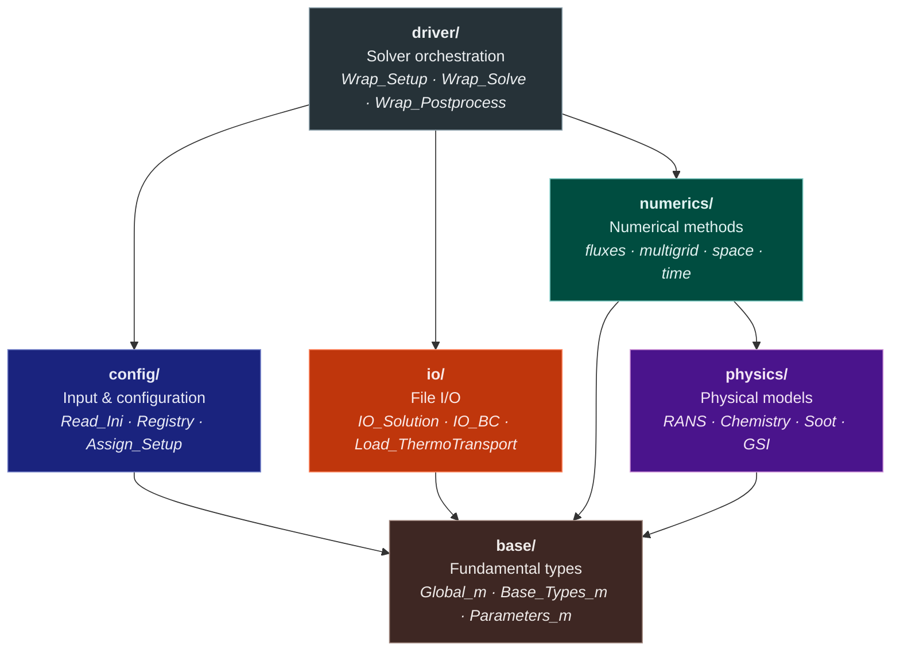
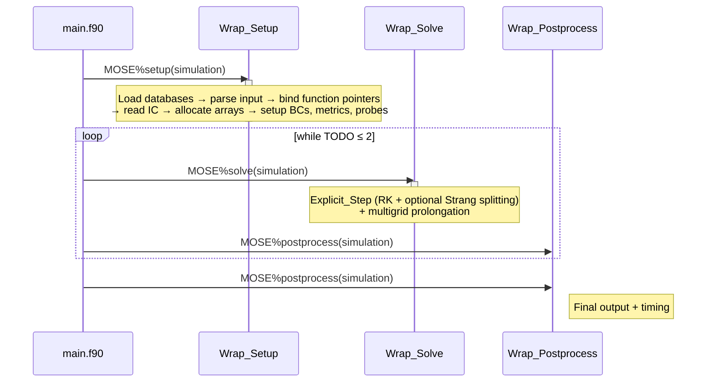

# Code Structure

This page documents the repository layout, the internal architecture
of the MOSE library, and the solver execution pipeline.

---

## Repository Layout

```
MOSE/
├── CMakeLists.txt          # Top-level CMake build
├── CMakePresets.json        # Developer presets (compilers, paths)
├── install.sh               # Build / compile / update helper
├── mkdocs.yml               # Documentation site configuration
│
├── src/
│   ├── app/                 # Executables
│   │   ├── main.f90         # MOSE solver entry point
│   │   └── docgen.f90       # Input-parameter documentation generator
│   └── lib/                 # MOSE library (libMOSEL)
│       ├── base/            # Fundamental types and global parameters
│       ├── config/          # Input parsing, registry, setup assignment
│       ├── diagnostic/      # Residual monitoring
│       ├── driver/          # High-level solver orchestration
│       ├── io/              # File I/O (solution, BCs, probes, walls)
│       ├── numerics/        # Numerical methods
│       │   ├── fluxes/      #   Riemann solvers, convective/diffusive flux
│       │   ├── multigrid/   #   Restriction / prolongation
│       │   ├── space/       #   Metrics, reconstruction, limiters, ghosts
│       │   └── time/        #   Time stepping (RK, IRS, Strang, newstate)
│       ├── parallel/        # MPI / OpenMP communication helpers
│       └── physics/         # Physical models
│           ├── turbulence/  #   RANS models (SA, SST, Wilcox, QCR, SSGLRR)
│           ├── Lib_Chemistry.f90
│           ├── Lib_GSI.f90  #   Gas-surface interactions
│           ├── Lib_RotatingFrame.f90
│           └── Lib_Soot.f90
│
├── lib/                     # External dependencies (git submodules)
│   ├── FLINT/               # Thermochemistry library
│   ├── ORION/               # Structured-grid I/O library
│   └── third_party/
│       └── FiNeR/           # INI file parser
│
├── test/                    # Validation test suite
│   ├── 1D/                  # 1-D shock tube cases
│   ├── 2D/                  # 2-D steady and unsteady cases
│   ├── 3D/                  # 3-D cases
│   ├── Pressure_Centrifugal_eq/  # Rotating-frame equilibrium cases
│   └── common/              # Shared thermodynamic databases
│
├── docs/                    # MkDocs documentation source
├── cmake/                   # CMake modules (flags, OpenMP, etc.)
├── bin/                     # Built executables (MOSE, DocGen)
└── build/                   # Build artefacts
```

---

## Dependencies

**Required submodules** (always linked, located in `lib/`):

| Library | Purpose |
|---------|---------|
| `FLINT` | Thermochemistry (internally depends on `OSLO` ODE solvers) |
| `ORION` | Structured multi-block grid I/O |
| `FiNeR` | INI file parser |

Optional compile-time dependencies are enabled via CMake flags; see [Key CMake options](#key-cmake-options) in the Build System section.
`ExactPack` (Python) is used only for V&V post-processing and is never linked at compile time.
It is a pip dependency of the test suite, not a submodule; see [Testing](testing.md).

---

## Library Architecture

The MOSE library (`libMOSEL`) is organised in six layers.  Lower
layers have no knowledge of higher layers.



---

## Solver Pipeline

The main program (`src/app/main.f90`) creates a `MOSE_type` object
and calls three phases: **setup**, **solve** (in a loop), and
**postprocess**.



### Explicit Step

Each call to `Explicit_Step` performs one complete time step:

1. **Compute Δt** — local and global time steps from CFL and von Neumann conditions.
2. **Strang splitting** (if `N_strang = 2`) — wrap the RK stages with two half-step chemistry
   integrations: RK(½Δt) → chemistry ODE(Δt) → RK(½Δt).
3. **Runge–Kutta loop** (repeated `n_RK` times per step):
    - Fill ghost cells (boundary and inter-block conditions). With MPI the halo
      exchange overlaps local work: receives and sends are posted first, the
      ghost cells of physical boundaries and of connections between local blocks
      are filled while the messages travel, then the receives are waited for and
      unpacked. Only after that are the tangential neighbours of each
      connection's source cell gathered (`bc%Pg(:,3:6)`, read by the viscous
      connection flux): at a vertex shared with blocks of other ranks some of
      them are ghost cells that arrive with the exchange.
    - Evaluate convective fluxes (reconstruction → Riemann solver)
    - Evaluate diffusive fluxes
    - Apply boundary fluxes
    - Add RANS source terms (if a turbulence model is active)
    - Add soot source terms (if the soot model is active)
    - Update conserved state via `RK_Newstate` (IRS smoothing + RK update)
4. **Compute residual** and write diagnostics.

The RK stages run inside one OpenMP parallel region. The MPI calls made inside it (the halo
exchange in `Fill_Ghost_Cell`, the exchange of the fluxes of the faces between ranks in
`Connection_Fluxes`, the exchange of the velocity gradient of the rotation–curvature correction
(SA-RC, SST-RC) in `Ghost_Velocity_Gradient`, the residual exchange of the implicit residual
smoothing) are made
by the primary thread only, in `!$omp master` blocks (OpenMP 5.1 added the `masked`
construct and deprecated `master`), each followed by an explicit
`!$omp barrier` wherever the other threads use its result. MOSE initialises MPI with
`MPI_THREAD_FUNNELED`, which allows MPI calls only from the thread that initialised MPI, and that
thread is the primary thread of the region. A `single` block may run on any thread of the team,
so it must not contain MPI calls. The `needs-mpi` test `MPIThreadFunnel` checks this.

---

## Convective Flux Evaluation

The convective flux at each cell interface is computed in five stages
from a 4-point stencil:

1. **Shock detection** — Jameson sensor flags cells near discontinuities.
2. **MUSCL reconstruction** — extrapolation to the interface using one of 5 flux limiters.
3. **Interface states** — left and right primitive-variable states at the face.
4. **Riemann solver** — one of 14 selectable solvers resolves the jump.
5. **Numerical flux** — result multiplied by the interface area vector F · A.

---

## Diffusive Flux Evaluation

The viscous, conductive and diffusive flux of an interior face comes from
`Diffusive_Flux` (`numerics/fluxes/Lib_Diffusive.f90`), which takes the face
metric as one argument:

```fortran
call Diffusive_Flux ( normal, area, waldis1, waldis2, kr1, kr2,          &
                      Prim1, Prim2, Visc1, Visc2, Visc3, Visc4, Visc5,   &
                      Visc6, Visc7, Visc8, Visc9, Visc10, Mf, Res1,      &
                      Res2, a, b, c, Sc, Sct, Prt, Prl, soot_enabled )
```

`Prim1` and `Prim2` are the primitive variables of the two cells, from 1 to 2
along the normal (the state of the face is their mean); `Visc1` and `Visc2`
their viscous variables, `Visc3`–`Visc6` and `Visc7`–`Visc10` those of their
neighbours along the two tangential index directions `b` and `c` (cell 1 at -1
and +1, then cell 2 at -1 and +1); `a` is the direction across the face. The
viscous variables of a cell are its mass fractions, velocity, temperature and
turbulence variables per unit mass (`Visc_State`, `Lib_Diffusive.f90`), the
quantities whose differences make the gradients. `Viscous_Variables`
(`numerics/fluxes/Mod_Fluxes.f90`) computes them once per stage, after the
ghost cells are filled, for every cell of the blocks of the rank and for the
first layer of ghost cells across the faces of each block, into `blk%Visc`;
the viscous fluxes of the interior faces and of the faces of types `101`,
`201` and `200` read them there (the cells of the other block of a face
between blocks, `bc%Pg`, are computed on the face). `Mf(3,3)` is the face metric: the
gradient is `Gradient(v,:) = matmul(D(v,:), Mf)`, with `D` the difference
across the face and the two tangential differences. `Res1` takes -flux and
`Res2` +flux.

The caller gets `Mf` from `Viscous_Face_Metric` (`numerics/space/Lib_Stencil_Metrics.f90`):

```fortran
Mf = Viscous_Face_Metric ( blk, d, i, j, k, metric )
```

for the face of direction `d` between cell `(i,j,k)` and the next one along
`d`, with `metric = obj_space_scheme%metric_mode` (`METRIC_MEAN` 0,
`METRIC_INVERSE_MEAN` 1, `METRIC_STENCIL` 2, from `diffusive-metric`). With
`mean` and `inverse-mean` it computes the metric from the cell metrics
`blk%M` and `blk%Minv` with the operations `Diffusive_Flux` used before;
with `stencil` it returns the metric stored at setup in
`blk%dir(d)%Mf(i,j,k)%c` by `Setup_Stencil_Metrics` (called at the end of
`Setup_Metrics`, on every multigrid level). `Fluxes_blk` does not copy a
stored metric: with `stencil` it passes `blk%dir(d)%Mf(i,j,k)%c` itself
through a contiguous pointer, and calls `Viscous_Face_Metric` only for
`mean` and `inverse-mean`; the symmetry and wall faces read their stored
metrics the same way. A caller that evaluates the interior viscous fluxes
elsewhere, for example with another time scheme, gets the bits of
`Fluxes_blk` by calling `Viscous_Variables` after its own fill of the ghost
cells and the two routines above the same way.

Boundary faces with `stencil`: a face between blocks (`101`, `201`) takes one
gradient through `Diffusive_Flux` (`BC_Connection_Visc_Stencil`), with the
metric stored on the face of the block of the record and the tangential
neighbours of the ghost cell from `bc%Pg(:,3:6)`; a symmetry face (`300`)
uses the stored metric of the cell and its mirror image in
`BC_Symmetry_Visc`. A wall face takes the metric and the tangential
differences of the wall temperature that `Wall_Face_Stencils` stores in its
record (`bc%wstencil`, `bc%wM`, `bc%wdT`): `BC_Wall_Temperature` and
`BC_Wall_Heat` read them through their optional argument `rec`, which every
caller passes (`BC_Fluxes`, the wall output). Faces of type
`200` (`BC_Rotational_Periodic_Visc`) take one gradient through `Diffusive_Flux`
with `stencil`, with the metric that `Rotational_Face_Metric` stores on the face
of the block (one per group of quantities with a wall ghost cell in the row of
the cell or of the source; the image row is the row of the source turned,
positions and values), and with `inverse-mean` and `mean` the inverse-mean
metric of the cell and its image, which depends on the mesh only:
`Setup_Metrics` computes it once (`Rotational_Periodic_Face_Metric`) and stores
it in the record (`bc%rM`), and `BC_Fluxes` passes it; the routine chooses by
`obj_space_scheme%stencil_metric`, so every caller passes `bc%rM`. Chimera faces (`102`)
keep their own metric with every option. The positions of the ghost cells that
enter the metric are listed in [Numerics](../theory/numerics.md).

With symmetry (`300`) on the two faces of an index direction that has fewer than two cells (the $k$ faces of a 2-D case,
the $j$ faces of a 1-D case), the second layer of ghost cells of each face copies the first layer of the other.
`Setup_Metrics` fills the ghost layers of the symmetry faces one layer at a time, each after the previous layer of every
face, so their metrics do not depend on the number or on the order of the OpenMP threads.

---

## RANS Turbulence Models

At run time `Assign_Setup` reads `turbulence_model` from the input file
and binds the selected implementation to four procedure pointers in `Mod_RANS`:
`Eddy_Viscosity`, `RANS_Diffusive_Flux`, `Stress_Vector`, and `RANS_Set_Wall_Values`.

| Key | Implementation | Description |
|-----|---------------|-------------|
| `SA` | `Lib_Spalart` | Baseline Spalart–Allmaras |
| `SAcomp` | `Lib_Spalart` | + compressibility correction (stops at set-up: its result depends on the units) |
| `SAR` | `Lib_Spalart` | + rotation correction |
| `SA-RC` | `Lib_SpalartShur` | Rotation–curvature (Shur) correction |
| `SST` | `Lib_SST` | Menter k-ω SST (SST-2003) |
| `SST-RC` | `Lib_SST`, `Lib_SpalartShur` | SST + rotation–curvature correction (Smirnov–Menter) |
| `Wilcox2006` | `Lib_Wilcox2006` | Wilcox k-ω (2006 revision) |
| `SSGLRR` | `Lib_SSGLRR` | Speziale–Sarkar–Gatski RSM |
| `QCR2000` | `Lib_QCR2000` | Quasi-curvilinear correction |

### Wall distance

`Wall_Distance_Blk` (`numerics/space/Lib_Metrics.f90`) gives every cell its distance to the wall surface
that [Turbulence](../theory/turbulence.md#wall-distance) defines, with `Bilinear_Face_Distance` for the
certified minimum and `Wall_Images` for the periodic images; $\mathbf{x}(s,t)$, $\mathbf{a}$, $\mathbf{b}$ and the
twist $\mathbf{T}$ of a wall face are those of that page. The distance to a wall face is its minimum over the face,
in one of two ways:

- **The four triangles** between its centre and its sides, when the face is
  plane to the resolution of its coordinates: they lie within
  $g = \min(|\mathbf{T}|/16,\ |\mathbf{T}\cdot\mathbf{n}|/(2|\mathbf{n}|))$ of
  the face, $\mathbf{n}$ the cross product of its diagonals (the second bound
  when the face, projected on the plane normal to $\mathbf{n}$, is convex). The
  face takes this way when a computed bound is within $8uM + \varepsilon$, with
  $u = 2^{-53}$, $M$ the largest coordinate of its corners in absolute value and
  $\varepsilon$ a proven bound of the rounding of that computation, which grows
  with $\kappa_n|\mathbf{T}|$, $\kappa_n$ = 1/sine of the angle between the
  diagonals. Every face of a 2-D mesh (a parallelogram) takes it, and every
  convex plane face whose corners are not within $(49 + 30\kappa_n)u$ of a
  straight or a null angle. Its distance is within $8uM + 2\varepsilon$ of the
  distance to the face, plus the rounding of the triangles. The distance to a
  triangle is the distance to its plane when the projection of the point falls
  inside it, otherwise the distance to the nearest side.
- **The certified minimum** on any other face: a branch and bound over the
  rectangles of $(s, t)$, depth first. Upper bounds are points of the face (its
  sides in closed form, the centre of each piece, projected Newton steps);
  the lower bound of a piece is the larger of the distance to its two
  triangles less $|\mathbf{T}_P|/4$, $\mathbf{T}_P$ the twist of the piece, and
  the distance to the convex hull of its four corners, both less a proven
  bound of their rounding; a piece is split in two across its longer side in
  space. The result is within $\tau + 32uS = 288uS$ of the distance,
  $S = |\mathbf{p} - \mathbf{x}_1| + |\mathbf{a}| + |\mathbf{b}| + |\mathbf{T}|$,
  $\tau = 256uS$: the rounding of the size of the face and of the distance,
  not of the coordinates. No case needs a treatment of its own: faces with a
  collapsed side, three corners on one point, a bowtie, a pinch or a reflex
  corner are plane or are treated the same way. The coordinates of the face
  relative to its first corner pass through `VOLATILE` variables, so that the
  compiler cannot rewrite them in terms of the coordinates themselves (as
  for the [cell volume](../theory/numerics.md#cell-volume)).
- A k-d tree over the face centres, with the radius of each face, finds the
  nearest face: the distance is computed only for the faces whose centre lies
  within the best distance found so far plus their radius. When some face takes
  the certified minimum, the search makes two passes over the tree: the first
  finds an upper bound of the distance (the triangles of each face plus the
  bound of their gap from the face and of the rounding), the second computes the
  certified minimum only on the faces whose triangles, less that bound, are not
  farther than it. Each pass gives the minimum of a function of the face alone,
  so the distance and the face that gives it do not depend on the shape of the
  tree, on the threads or on the ranks.
- The distinct translations of the periodic boundaries are reduced
  to a basis $B_1 \ldots B_n$ of the lattice they generate, shortest first,
  and then pairwise (Lagrange: $B_j$ becomes $B_j - m B_i$, $m$ the integer
  nearest to $B_i\cdot B_j / B_i\cdot B_i$, while that shortens it) and, with
  three translations, by threes ($B_l$ becomes $B_l - m_i B_i - m_j B_j$, with
  $m_i, m_j$ the integers nearest to the least-squares coefficients of $B_l$ on
  $B_i, B_j$ or next to them, while that shortens it). Three nearly dependent
  translations can be reduced pair by pair (no pairwise step shortens them)
  and still have a short sum: $B_1 = (1, 0, 0)$,
  $B_2 = (-\tfrac12, \tfrac{\sqrt3}{2}, 0)$,
  $B_3 = (-\tfrac12, -\tfrac{\sqrt3}{2}, \varepsilon)$ give
  $B_1 + B_2 + B_3 = (0, 0, \varepsilon)$, which only the step by threes finds.
  Each step adds to a vector an integer combination of the others, so the
  lattice is the same, and the bound below holds for any basis of it: the
  reduction only keeps the number of images small. The
  images are the integer combinations $\sum_i k_i B_i$ of the basis.
- Only a bounded set of images can hold the nearest wall, whatever the size of
  the mesh against its periods. Let $B^*_i$ be the dual basis
  ($B^*_i\cdot B_j = \delta_{ij}$), $G_{ij} = B_i\cdot B_j$ the Gram matrix,
  and $w_i = B^*_i\cdot w$ the coordinates of a vector $w$. Every wall face
  is moved, whole, by the lattice vector that brings its centre $m$ to
  $|(m - a)_i| \le 1/2$, $a$ the centre of the first wall face, and so is the
  centre $c$ of every cell before its search: the periodic wall is the same
  set. Let $p$ be the point of a face nearest to $c$ over all the images, and
  $s$ the image that holds it: $s$ is a lattice vector closest to $v = c - p$
  (another one would bring a point of the same face nearer), so $u = v - s$ is
  not farther from 0 than from $\pm B_j$, $|u\cdot B_j| \le G_{jj}/2$, and
  since $u_i = \sum_j (G^{-1})_{ij}\, u\cdot B_j$,
  $|u_i| \le \beta_i = \tfrac12 \sum_j |(G^{-1})_{ij}|\, G_{jj}$ ($1/2$ on
  an orthogonal basis). Every point of a face is a convex combination of its
  corners, so $|(p - m)_i| \le \rho_i$, $\rho_i$ the largest
  $|(q - m)_i|$ of a corner $q$ of a face, and
  $|v_i| \le |(c - a)_i| + |(m - a)_i| + |(p - m)_i| \le 1 + \rho_i$. The
  coefficients of $s$ are $k_i = v_i - u_i$: the images searched are
  $|k_i| \le \lfloor 1 + \rho_i + \beta_i \rfloor$, one on each side
  ($|k_i| \le 1$) when $\rho_i < 1/2$ on an orthogonal lattice. On a sector
  every translation lies along $x$, and the turns keep the coordinate along
  $x$, so the same bound holds for each turn. An image is searched only when
  the box around the moved wall, seen from the cell moved back by the image,
  is not farther than the distance found so far, so a mesh without periodic
  boundaries costs nothing more. Translations that do not form a lattice stop
  the run: one that is not an integer combination of the others, more than
  three independent ones, or one not along $x$ on a wedge or with sectors; so
  does a number of images too large for an integer.

Twisted wall faces in 3-D. The four triangles of a face whose corners are not
coplanar lie within $|\mathbf{T}|/16$ of it, and with them the distance would be
wrong by up to $(|\mathbf{T}|/16)/y$: on a unit face twisted by $t = |\mathbf{T}|$,
at the height $h$, 6 % for $t = h = 0.1$, 62 % for $t = 10^{-2}$ and
$h = 10^{-3}$, and 62 times the distance for $t = 0.1$ and $h = 10^{-4}$. Such a
face takes the certified minimum, and its distance is exact to the rounding.
2-D and axisymmetric meshes are not affected: their wall faces are plane and
take the four triangles.

---

## Data Structures

The top-level type `MOSE_simulation_type` holds an array of grid levels
(one per multigrid level) and an I/O container:

```
MOSE_simulation_type
├── domain(:)   MOSE_domain_type    — one entry per multigrid level
│   ├── blk(:)  MOSE_block_type     — one entry per structured block
│   │   ├── P(:,:,:,:)  real64      — primitive variables
│   │   ├── C(:,:,:,:)  real64      — conservative variables
│   │   ├── R(:,:,:,:)  real64      — residual (flux accumulator)
│   │   └── dtlocal(:,:,:)  real64  — local time step
│   ├── nb      integer             — number of blocks
│   ├── iter    integer             — iteration counter
│   ├── time    real64              — physical time
│   └── dtglobal real64            — global time step
└── IOfield(:)  IOfield_type        — I/O metadata
```

| Array | Shape | Content |
|-------|-------|---------|
| `P` | `(nprim, ni, nj, nk)` | Primitive variables |
| `C` | `(ncons, ni, nj, nk)` | Conservative variables |
| `R` | `(ncons, ni, nj, nk)` | Residual (flux accumulator) |
| `dtlocal` | `(ni, nj, nk)` | Local time step per cell |

---

## Build System

### CMake targets

| Target | Type | Description |
|--------|------|-------------|
| `MOSEL` | Static library | Core solver + all physics/numerics; links FLINT, ORION, FiNeR |
| `MOSE` | Executable | Standalone solver (`src/app/main.f90`) |
| `DocGen` | Executable | Input-parameter docs generator (`src/app/docgen.f90`) |

### Build workflow

```bash
# Option A: install.sh (recommended for first build)
./install.sh build --compilers=gnu

# Option B: CMake presets (for iterative development)
./install.sh compile          # uses CMakePresets.json
# or equivalently:
cmake --preset default && cmake --build build
```

### Key CMake options

| Option | Default | Library | Effect |
|--------|:-------:|---------|--------|
| `USE_OPENMP` | OFF | OpenMP | Enable shared-memory threading |
| `USE_MPI` | OFF | MPI | Enable distributed-memory parallelism |
| `USE_SUNDIALS` | OFF | SUNDIALS | Alternative ODE solvers for chemistry |
| `USE_CANTERA` | OFF | Cantera | Alternative chemistry backend |
| `USE_TECIO` | OFF | TecIO | Enable Tecplot binary output |
| `BASIC_TEST` | OFF | — | Build unit tests in `src/test/` |

### Dependency paths

External library paths are set via CMake cache variables or the
`install.sh --include-*` flags:

| Variable | Default | Library |
|----------|---------|---------|
| `ORION_PATH` | `lib/ORION/` | ORION I/O |
| `FLINT_PATH` | `lib/FLINT/` | FLINT thermochemistry |
| `OSLO_PATH` | `lib/FLINT/lib/OSLO/` | OSLO ODE solvers |
| `FINER_PATH` | `lib/third_party/FiNeR/` | FiNeR INI parser |

---

## Naming Conventions

| Convention | Example | Meaning |
|------------|---------|---------|
| `MOSE_` prefix | `MOSE_Global_m` | Public Fortran module |
| `obj_` prefix | `obj_sim_param` | Global configuration singleton |
| `Lib_` prefix | `Lib_SST` | Computational routine library |
| `Mod_` prefix | `Mod_Riemann` | Module with types + pointers |
| `Wrap_` prefix | `Wrap_Solve` | Driver-level wrapper |
| `_m` suffix | `Config_Types_m` | Fundamental type module |
| `_type` suffix | `MOSE_block_type` | Derived type |
