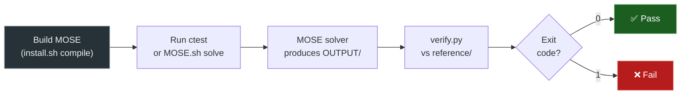

# Testing

MOSE ships with a validation test suite that exercises the solver on
canonical problems with known analytical or reference solutions.  This
page describes the test organisation, how to run tests, and how to add
new cases.

---

## Test Organisation

```
test/
├── 1D/                        # 1-D shock tube validation cases
│   ├── Sod79/
│   ├── Tor99/
│   ├── Ein91/
│   ├── Noh87/
│   └── Shu-Osher/             # Mach-3 shock / sine-wave interaction
├── fast/                      # Fast pre-push tests (hard-invariant checks)
│   ├── riemann-smoke/         # Every shock-capturing solver stays positive
│   ├── numerics-smoke/        # Limiter / time-scheme / recon / int-var sweep
│   ├── conservation/          # Closed slip-wall box conserves mass
│   ├── openmp-equiv/          # 1 vs 4 threads bit-identical
│   ├── restart/               # Restart round-trip reproduces uninterrupted run
│   │   └── restart-counters/  # Restarts carry on iteration, output and level counters
│   ├── input-checks/          # Input checks
│   │   ├── exit-codes/        # Runs stopped on an error end with a non-zero exit code and their message, valid runs with 0
│   │   ├── limiter-defaults/  # The reconstruction that runs is the declared one
│   │   ├── irs-time-accurate/ # Residual smoothing refused in time-accurate runs
│   │   ├── decomposition-map/ # Block-to-rank map on one rank: same bits, misfit maps stop
│   │   └── runtime-input/     # input.ini read again during a run: the rules apply, the keys left out keep their values
│   ├── connections/           # Faces between blocks
│   │   ├── chimera-face/      # Viscous stencil of chimera faces at the edges of a block face
│   │   ├── connection-flux/   # One flux per face between blocks: one block = two blocks, conservation
│   │   ├── connection-order/  # Faces between blocks of the same parity: any order of bc.txt, same bits
│   │   └── sector-radial/     # A 3-D sector closed by type 200 keeps a radial flow mirror-symmetric
│   ├── time-integration/      # Time integration
│   │   ├── time-control/      # Time-dependent inlet order, time tables, stop criteria
│   │   ├── local-time-step/   # Local time step stable on square/skewed/cubic cells and in diffusive cells
│   │   ├── turbulence-sources/ # Time order and positivity of the turbulence sources; Wilcox 2006 vortex stretching; asymptotic omega wall value
│   │   └── quasi2d-symmetry/  # Quasi-2D, symmetry k faces: round-off in w does not grow
│   ├── boundary-conditions/   # Boundary conditions
│   │   ├── inlets/            # Inlet boundary conditions: direction normal, total conditions
│   │   ├── bc-input/          # Property lines of bc.txt read as written or refused
│   │   └── rotating-frame/    # Rotating frame: stationary faces read and listed, the run ends
│   ├── mesh-geometry/         # Mesh geometry
│   │   ├── wall-distance/     # Distance to the wall = exact distance to the wall surface
│   │   └── mesh-type/         # Plane mesh, wedge or periodic sector from every node
│   └── output-files/          # Output files
│       ├── wall-output/       # Wall output in vtk raw: every wall file has the extent, the points and the cell values of its face
│       ├── vtk-names/         # Names and times of the VTK outputs
│       └── vtk-raw-format/    # vtk raw outputs hold raw appended data
├── unit/                      # Unit checks of library functions, built against the library
│   └── qcr2000_check.f90      # QCR2000 stress, called as the solver calls it, against its definition
├── 2D/                        # 2-D validation cases
│   ├── euler/                 # Inviscid cases
│   │   ├── oblique-shock/
│   │   ├── prandtl-meyer/
│   │   ├── ramp-channel/
│   │   ├── hypersonic-cylinder/
│   │   ├── chang-nozzle/
│   │   ├── rocket-nozzle/     # Subdirs: frozen/ equilibrium/ finite-rate/
│   │   └── supersonic-forward-step/
│   └── viscous/               # Viscous cases
│       ├── flat-plate-laminar/
│       ├── flat-plate-turbulent/
│       ├── Flat_Plate_SGGLRR/
│       ├── mms/                   # residuals/: right-hand sides on manufactured fields (RANS, wedge)
│       ├── wedge-axis-step/       # Local time step next to the axis of the wedge (validation tier)
│       ├── point-implicit-steady/ # Steady state with the point-implicit factor independent of the time step
│       └── swbli/
├── mpi/                       # MPI tier (needs-mpi): make_case.py, write_map.py
│   ├── boundary-records/      # Boundary records
│   ├── connection-flux/       # Faces between ranks
│   ├── connection-order/      # The 2-D case of ConnectionOrder with one block per rank
│   ├── vertex-stencil/        # Viscous connection stencil at a vertex shared by four blocks
│   ├── thread-funnel/         # MPI calls only from the main thread (MPI_THREAD_FUNNELED)
│   ├── decomposition-map/     # Block-to-rank maps on 2 and 4 ranks: the one-rank field
│   ├── exit-codes/            # An input error on rank 0, or read again by rank 1 alone, stops both ranks of a 2-rank run
│   └── restart/               # Exact restart from vtk raw on 2 ranks x 2 threads
├── 3D/                        # 3-D validation cases
│   └── coriolis-channel/
├── Pressure_Centrifugal_eq/   # Rotating-frame equilibrium case
└── common/                    # Shared thermodynamic databases
    ├── Air/                   # 5-species air (dimensional)
    └── nondim-Air/            # 5-species air (non-dimensional)
```

### Categories

| Category | Location | What is checked |
|----------|----------|-----------------|
| **1-D shock tubes** | `test/1D/` | Density, velocity, pressure profiles against exact solutions (ExactPack) |
| **2-D inviscid** | `test/2D/euler/` | Converged Euler flow fields against reference data |
| **2-D viscous** | `test/2D/viscous/` | Converged Navier–Stokes / RANS solutions against reference data |
| **3-D** | `test/3D/` | 3-D flow cases |
| **Rotating frame** | `test/Pressure_Centrifugal_eq/` | Centrifugal equilibrium in a rotating reference frame |
| **Common** | `test/common/` | Shared thermodynamic databases used by multiple cases |

---

## Test Case Structure

Each test case is a self-contained directory:

```
test/1D/Sod79/
├── input.ini          # Solver input file
├── INPUT/             # Initial-condition files
├── MESH/              # Grid files
├── reference/         # Reference solution data
├── verify.py          # Comparison script (exit 0 = pass, exit 1 = fail)
└── MOSE.sh            # Run script
```

The key components are:

| File / Dir | Purpose |
|------------|---------|
| `input.ini` | Solver configuration (Riemann solver, CFL, output, ...) |
| `MESH/` | Pre-generated structured grid |
| `INPUT/` | Initial-condition field (ORION format) |
| `reference/` | Reference solution data |
| `verify.py` | Python script that compares solver output against the reference and returns exit code 0 (pass) or 1 (fail) |
| `MOSE.sh` | Convenience script to compile, run, or kill the solver |

---

## Running Tests

The validation cases are driven by **CTest** (see
[Automated Test Tiers](#automated-test-tiers-ctest-ci) below for the full
picture).  The quickest checks:

```bash
cd build

# The whole suite wired into CTest
ctest

# Just the fast pre-push tier (a few tens of seconds)
ctest -L fast

# A single case, with live output
ctest -R Sod79 -V
```

Individual cases can also be run directly from their own directory, which
is handy when iterating on a single problem.

### Single test case

2-D and 3-D cases are run individually from their own directory:

```bash
cd test/2D/euler/oblique-shock

# Compile a local MOSE binary
./MOSE.sh compile

# Run the solver
./MOSE.sh solve

# Run with OpenMP (4 threads)
./MOSE.sh -p 4 solve

# Run in background
./MOSE.sh -b solve

# Verify against reference
python3 -B verify.py
```

---

## Automated Test Tiers (CTest & CI)

The most important cases are wired into **CTest** so they can run
unattended in a Git pre-push hook and in GitHub CI.  Tiers are expressed
through CTest **labels**
(defined in [`test/CMakeLists.txt`](https://github.com/open-hydra/MOSE/blob/main/test/CMakeLists.txt)):

| Label | Meaning |
|-------|---------|
| `fast` | Tiny, dependency-free, a few seconds each — run by the pre-push hook |
| `validation` | Analytic or reference comparison |
| `numerics` / `implementation` | Coverage area (numerical scheme vs. plumbing) |
| `needs-cantera` / `needs-sundials` / `needs-mpi` | Requires the matching optional dependency; excluded from the minimal CI build |

Run a tier from the build directory:

```bash
cd build

# Everything wired into CTest
ctest

# Just the fast pre-push tier
ctest -L fast

# Everything except heavy-dependency cases (what the first job of PR CI runs)
ctest --label-exclude "needs-cantera|needs-sundials|needs-mpi"
```

### Where each tier runs

| Tier | Trigger | Selector |
|------|---------|----------|
| **Fast** | `git push` (pre-push hook, [`.githooks/pre-push`](https://github.com/open-hydra/MOSE/blob/main/.githooks/pre-push)) | `ctest -L fast` |
| **PR CI** | pull request to `main` ([`ctest.yml`](https://github.com/open-hydra/MOSE/blob/main/.github/workflows/ctest.yml)) | `ctest --label-exclude "needs-*"`; in a second job built with MPI, `ctest -L needs-mpi` |
| **Nightly / dispatch** | scheduled / manual | full suite with Cantera + Sundials + MPI |

The first CI job builds MOSE deliberately minimal (`USE_MPI=OFF`, `USE_TECIO=OFF`,
`USE_SUNDIALS=OFF`, `USE_CANTERA=OFF`), so finite-rate chemistry,
equilibrium and binary-Tecplot cases cannot run there — they live in
the nightly tier. The second job, `test-mpi`, builds MOSE with gfortran, the
Open MPI of Ubuntu and `USE_MPI=ON`, and runs the `needs-mpi` tier.

To enable the pre-push hook locally:

```bash
git config core.hooksPath .githooks
```

### Fast tier contents

The fast suite asserts **hard invariants** (positivity, conservation,
bit-for-bit reproducibility) on tiny meshes — no digitized references, no
plotting, no optional dependencies — so it stays green in a few tens of
seconds on a CI runner.

| Test | Asserts | Reuses |
|------|---------|--------|
| `Sod79` | shock/contact positions, positivity | `test/1D/Sod79` |
| `Einfeldt91`, `Noh87`, `Toro99` | profiles vs ExactPack | `test/1D/{Ein91,Noh87,Tor99}` |
| `ShuOsher` | coarse (N=200) L1 density error vs an N=1600 reference | `test/1D/Shu-Osher` |
| `PrandtlMeyer` | analytic turning angle | `test/2D/euler/prandtl-meyer` |
| `RiemannSmoke` | every shock-capturing solver stays positive (no NaN, ρ,p>0); with shock-detector = Tramel the set-up summary names the shock sensor, with HLLC and with HLLC+Tramel, which gives the field of the run without the key | `test/fast/riemann-smoke` |
| `NumericsSmoke` | all limiters × time schemes × recon × integration vars stay positive | `test/fast/numerics-smoke` |
| `InputChecks`/`LimiterDefaults` | MUSCL without `flux-limiter` runs van Leer and first-order ignores a given limiter (fields bit-identical to the explicit settings), with the matching set-up warnings and summary | `test/fast/input-checks/limiter-defaults` |
| `InputChecks`/`IRSTimeAccurate` | a time-accurate run with implicit residual smoothing (`irs = true` or `irs-beta > 0`) is refused at set-up; steady runs keep it | `test/fast/input-checks/irs-time-accurate` |
| `BoundaryConditions`/`Inlets` | an ambient inlet (407) with the flow direction `normal` gives the field of the angles the token stands for on that face, to the bit, with no transverse velocity; inlets at total conditions in a 1-D tube of air, one forward Euler step with first-order reconstruction: the mass flux of each inlet face equals that of the face state within 1e-9 of rho a — ambient (407) and inlet (401) faces with the gas at rest and p0 = 2 p (subsonic inflow, 0.7701 rho a) or 36 p (choked, normal Mach 1, 20.83 rho a), on both ends; an inlet with p0 below the pressure the gas of the cell reaches at rest is a slip wall; an ambient (407) face that the reservoir cannot feed, with the gas of the cell moving in at 0.5 a or 1.2 a, is an outlet at p_back (0.0590 and 0.0389 rho a out), and at rest at p_stop with p_back above it (no mass) | `test/fast/boundary-conditions/inlets` |
| `TimeIntegration`/`TimeControl` | second order in time with a time-dependent inlet (BC 402) for RK2 and RK3; a time table holds its first value before its first instant; `res-threshold` does not end a time-accurate run | `test/fast/time-integration/time-control` |
| `Conservation` | closed slip-wall box conserves total mass to round-off | `test/fast/conservation` |
| `BoundaryConditions`/`RotatingFrame` | a rigid-body rotating frame with two `stationary-face-<n>` entries: the run ends within 60 s with exit code 0 and its set-up summary lists the two stationary patches | `test/fast/boundary-conditions/rotating-frame` |
| `OpenMPEquiv` | 1 vs 4 threads bit-identical: the Sod tube, and a block overset on another whose four chimera faces meet at its edges (Navier–Stokes) | `test/fast/openmp-equiv` |
| `Connections`/`ChimeraFace` | the viscous stencil of chimera faces, one evaluation of the residual of a linear field on two blocks that overlap with their ghost cells on cells of the other block: with u = G y in 2-D and u = G (y + z) in 3-D the y and z momentum residual is zero also in the cells at the ends of the chimera faces; with a radial velocity on a 2-D wedge of 1 degree the momentum residual of every cell is that of the same mesh as one block (within 1e-9 of μ G / H) | `test/fast/connections/chimera-face` |
| `Restart` | split + restart reproduces the uninterrupted run; at a restart a missing probe file is written again and an existing one is appended to, with the rows of the uninterrupted run: to the precision of the file with Tecplot ASCII, bit for bit with `vtk raw`, iteration counters and output numbering included | `test/fast/restart` |
| `OutputFiles`/`WallOutput` | a vtk raw run of a 2x2-block box with no-slip walls on its four sides ends, and every wall file `wallB<b>F<f>.vts` has the extent of its face, taken from `fieldBlock<b>.vts`, as WholeExtent and as Piece Extent, its points and one value of each wall variable per cell (a direction with one plane of nodes counts one layer of cells, as in the cell-centered ordered data of the Tecplot format), as raw appended data | `test/fast/output-files/wall-output` |
| `Restart`/`RestartCounters` | with `vtk raw`, steady (CFL ramp, numbered solutions, diagnostic output, a probe every 3 iterations), time-based output and two-level multigrid restarts write the same files, byte for byte, as the uninterrupted runs; a time-accurate restart from a steady solution starts at t = 0; in a time-accurate run with probes by time, by iteration and by both, the probe by time writes one row per multiple of its `dtime`, from the first, and the probe by iteration no row by time | `test/fast/restart/restart-counters` |
| `OutputFiles`/`VtkNames` | field, wall and diagnostic `vtk raw` outputs of a steady viscous run are well-formed XML and name their arrays after the variables MOSE writes | `test/fast/output-files/vtk-names` |
| `InputChecks`/`RuntimeInput` | a 2x2-block viscous box with input.ini read again every 20 iterations: cfl = -1 stops the run at setup and, written during the run, at its next reading with the message of the rule; with an input.ini that holds the required keys only, and with one that also writes integration-variables, riemann-solver and flux-limiter, read again every 5 iterations, the run reaches iteration 10 with the residual history of the same run without readings; a comment line with "=" before cfl in its section is skipped: the run with it writes the residual history of the same run without it, and the setup names no key as not read; in a rigid-body frame about x with the wall of x = 0 at rest, omega written from 1e4 to 2e4 rad/s during the run goes on, from the reading of iteration 20, as the restart from iteration 20 with 2e4 from its set-up (residual history and solution of iteration 30 byte for byte), while rotational-frame = none, another stationary face or axis = NaN 0.0 0.0 stops the run at that reading | `test/fast/input-checks/runtime-input` |
| `OutputFiles`/`VtkRawFormat` | with `sol-format = vtk raw`, every block file of the field and diagnostic outputs of a steady and of a time-accurate run holds raw appended data, before and after the first diagnostic output | `test/fast/output-files/vtk-raw-format` |
| `InputChecks`/`ExitCodes` | a run stopped on an error ends with a non-zero exit code and its message, writing no solution: the Sod tube as a viscous mixture of four species without `schmidt` and `diffusion.dat` stops at setup; so does a run with a probe of an unknown variable, with exit status 1 and the name of the variable; the Sod tube that diverges, with an initial condition of too few variables, with a rotating frame of zero axis, of NaN axis or of infinite origin (with the key), with chemistry = equilibrium and no elements, with a value outside the rule of the registry: `preconditioning-eps-min = 1` against `in (0, 1)`, a value 0 in the list `ode-relative-tol-species` against `> 0`, a negative index in the `index-position` of a probe against `>= 0`; a NaN velocity in one cell or an infinite coordinate of one node of the initial condition stops the run at setup, in every build, with exit code 1, the place of the value and the STOP line; the table of an inlet 402 (the duct of BCInput) with a NaN or an infinite pressure, or a NaN time, stops the run at setup with exit code 1, the line and the column; a property line of `bc.txt` with a value that is not finite (the duct with an inlet 401 of NaN or infinite total pressure or of NaN `alpha`, its inlet 402 with an infinite total temperature, a wall 302 of NaN roughness under Navier–Stokes) stops the run at setup with exit code 1, the line, the record, its type and the name of the value; the duct with its inlet a face 410 whose file holds a NaN pressure or an infinite `SOLUTIONTIME` stops the run at setup with exit code 1, the file, the zone and the line of its header, and so does a file that cannot be read: missing, cut in the values of a zone, with a word among them, with `I=two` in a zone header, with no `I=` or no `J=` in it (`I = 3`, `j=2`), with one value more in a zone, with its zones in decreasing time; an input.ini that cannot be read stops at setup with its reason: missing ("cannot be opened"), empty, of comment lines only (an error of the INI reader); a key of input.ini whose value does not read as its type (`sol-dtime` = `NaN`, `Infinity` or `0,5`, `sol-diter` = `seven` or `2.5`, `sol-overwrite = yes`, `levels = 2.0` of `[MOSE-Multigrid]`) stops the run at setup with exit code 1, the file, the section, the key and the value as written, and the STOP line; a number too large for a real, such as `1e999`, is not among the cases: a DEBUG build (gfortran with `-ffpe-trap=overflow`) stops with SIGFPE in the read itself, exit code 136, before MOSE can check the value, while the TESTING and the ifx RELEASE builds stop at setup with the message (gfortran reads it as an infinity, ifx refuses it); a steady run with a soot model, with and without Spalart–Allmaras, ends normally and its diagnostic output names every variable it writes; the same state with `turbulence = SAcomp` stops at set-up with the message (a correction whose result depends on the units); a steady single-species run with sol-variables = none stops with a message that names thermo or transport; a valid run with finite-rate chemistry and exclude-blocks = 1 ends with 0, its set-up summary listing block 1 under the inactive blocks; exclude-blocks with a word that is not a block number (`x 1`, `1 x`) or with a block beyond the mesh (`1000`) stops at set-up with exit code 1 and the message that names the key, the value and the word or the block; the tube filled with steam far from chemical equilibrium (the 13 C-H-O species of the equilibrium nozzle), its block excluded from chemistry = equilibrium, has the bits of the run without chemistry, on one grid and on two multigrid levels, and with the block not excluded the equilibrium changes the state | `test/fast/input-checks/exit-codes` |
| `TimeIntegration`/`Quasi2DSymmetry` | quasi-2D case with symmetry k faces: p, u, v stay uniform and round-off in w does not grow (Heun, RK3); the same in a 1-D tube with symmetry j and k faces for v and w; a channel of variable section in a layer between parallel planes inclined to z and a 1-D channel of variable section keep the velocity across, with the warning, and p within 0.03 p0 of the quasi-1-D flow | `test/fast/time-integration/quasi2d-symmetry` |
| `TimeIntegration`/`LocalTimeStep` | the step is stable at cfl 0.8 on square and on skewed 2-D cells and on cubic 3-D cells, in diffusion-dominated cells set by heat conduction and by species diffusion with the default cfl and vnn (Heun, RK3), and in the 1-D shock tube at cfl 0.99; on a periodic block of 8³ rhombohedra with every edge angle at 115°, where the viscous operator exceeds the rate 4 D sum_d |grad xi_d|^2 by 1.0365, heat conduction with Heun at vnn 0.5 decays over 600 steps | `test/fast/time-integration/local-time-step` |
| `QCR2000Stress` | the quadratic constitutive relation QCR2000, called as the solver calls the stress (laminar viscosity, then eddy viscosity) on a 3-D velocity gradient, gives tau_QCR · n of the definition with the eddy viscosity alone and the laminar stress with the laminar viscosity alone | `test/unit/qcr2000_check.f90` |
| `TimeIntegration`/`TurbulenceSources` | in time-accurate runs with Spalart–Allmaras and SST, nu~, k and omega converge in time with the order of Heun (≥ 1.8) and RK3 (≥ 2.7), and no stage makes them negative when near-wall turbulence decays faster than the transport acts; a time-accurate SST-RC run with no cfl-rise-threshold prints both the k-omega and the -RC start-up warnings; with Wilcox 2006, one step of a 3-D linear flow changes rho omega by the source with the vortex-stretching function f_beta of the specification, chi_w = W_ij W_jk S^_ki/(beta* omega)^3 with the off-diagonal part of S^; with omega-wall-bc = asymptotic, a channel at rest whose omega is the wall value 6 nu/(beta d^2) of the model (beta_0 for Wilcox 2006, beta_1 for SST) changes rho omega in the wall cells by the destruction alone | `test/fast/time-integration/turbulence-sources` |
| `MMSResiduals` | on a constructed field with variable density and nu~, the right-hand side of the equation for rho nu~ converges with second order to the standard conservation form of Spalart–Allmaras; with SA-RC and SST-RC, the change of rho nu~ (rho k and rho omega) in one step of a 3-D flow with vorticity along x, y and z is the same as for the flow turned in space (x to y, y to z, z to x), cell by cell: the rotation tensor W_ij = (∂u_i/∂x_j − ∂u_j/∂x_i)/2 is a tensor; with SA-RC in a frame turning about z, a uniform shear changes rho nu~ by the production with the f_r1 of the specification, whose r~ takes the rotation of the frame, and a uniform flow, whose vorticity is zero, runs and keeps rho nu~; on air at rest next to a wall, and off the wall row of air flowing along it on cells stretched along the flow, SA-RC changes rho nu~ as SA does; on Homann's axisymmetric stagnation-point flow and on a polynomial field with dilatation and swirl (2-D wedge of 1°, axis included) the viscous force converges with second order to the Navier–Stokes one, the stress on the wedge faces included; with nu~ = a y over a wall, fluid at rest (an equilibrium of the equation for chi -> 0), the right-hand side of rho nu~ vanishes in the wall cells too, where the source terms must see grad nu~ = a from the wall value nu~ = 0 | `test/2D/viscous/mms/residuals` |
| `Connections`/`ConnectionFlux` | a periodic shock tube as one block and as two blocks gives the same bits, and conserves mass, momentum and energy to 1e-13, with HLLC, HLLC+Tramel, HLLC+Chen (shock sensor) and HLLC-PC (preconditioned, on a low Mach number wave) | `test/fast/connections/connection-flux` |
| `Connections`/`ConnectionOrder` | two 2-D blocks whose index directions are permuted across the cut (face 4 of one on face 2 of the other, two faces of the same parity) give the same bits with the records of `bc.txt` sorted and reversed (Navier–Stokes, HLLC+Tramel, a shock leaving the cut); with the block below the cut one cell thick across it, or two cells thick with two multigrid levels (one at level 2), the run stops at set-up with a message that names the record, the block across, its cells and the level | `test/fast/connections/connection-order` |
| `InputChecks`/`DecompositionMap` | on one rank, an `INPUT/decomposition.map` with every block on rank 0 gives the bits of the run without it and the setup log names the file, also the map written by MDB for its halo-trade test (kept byte for byte, on a case with its block sizes); maps that do not fit the mesh or the run (a block line missing or one too many, blocks out of order, other sizes or cell counts, a rank the run does not have, no rank column, a number written as a real, a directory in place of the file) stop the run at setup with the fault named | `test/fast/input-checks/decomposition-map` |
| `MeshGeometry`/`WallDistance` | the distance to the wall read back from the Spalart–Allmaras source is the exact distance to the wall surface (convex corner, curved wall, nozzle lip on a wedge), and to its periodic images (channel and pipe periodic in x, 3-D sector, the channel with its periodic sides matched to 1e-8, 3-D slab periodic in k, 3-D channel periodic in x and z with periods a hundredth of its height, the 2-D channel ten periods from the origin, a staggered row of plane blades longer than the period, a 3-D block periodic along three nearly dependent translations, the 2-D channel turned by 30 degrees with its coordinates rounded to 5 and to 4 significant digits); the stop at set-up of that channel rounded to 2 digits, whose periodic sides do not match to 1e-2 of its cells; on a 3-D wall of twisted faces, the start-up report of the bound of the error | `test/fast/mesh-geometry/wall-distance` |
| `MeshGeometry`/`MeshType` | a plane slab is plane and a wedge is a wedge whatever the direction of j (wall distance within 1e-9), also a wedge of 5 degrees in two blocks written with 5 significant digits and a plane slab far from the x axis, which a small turn nearly fits; the set-up summary names the type; a wedge written with 2 significant digits, too few to tell it, a plane slab whose k planes are not parallel (2 % of its thickness), 3-D sectors of 90 degrees whose periodic plane misses the turn by half a cell (100 cells in k) or a tenth (20 cells), and a wedge block with a plane block stop the run; a 3-D slab periodic in k keeps a uniform flow within 1e-12 | `test/fast/mesh-geometry/mesh-type` |
| `Connections`/`SectorRadial` | a 3-D sector closed by the rotational periodicity (type 200 on the k faces, -45 to 45 degrees) keeps a radial flow its own mirror image across z = 0 within 1e-10 | `test/fast/connections/sector-radial` |
| `BoundaryConditions`/`BCInput` | the property lines of bc.txt are read as written or refused: the table of an inlet 402 gives the same run under a plain name, a name with a directory, a long name and a quoted name; a missing table, or one whose times decrease, stops the run; a table that starts after the run gives its first value before; a property line with an empty value, short of a value, with a word for a number or with a misspelt flow direction stops the run | `test/fast/boundary-conditions/bc-input` |

A few heavier checks carry the `validation` (not `fast`) label because they
need reference data or plotting — for example `ShuOsherConvergence`, a 4-grid
Shu–Osher Richardson study (N=200/400/800/1600) that estimates a grid-independent
solution by Richardson extrapolation, asserts a sane observed order and monotone
L1 convergence against it, and regenerates the V&V figure. `PointImplicitSteady`
(`test/2D/viscous/point-implicit-steady`) is there for its
cost, 14 000 iterations per model: the steady state of a short hypersonic plate
with the point-implicit factor (Spalart–Allmaras, SST) does not depend on the
time step, and implicit residual smoothing does not move it either (wall shear
and heat flux to 1e-9). `WedgeAxisStep`
(`test/2D/viscous/wedge-axis-step`) is there for its cost too, eight runs of
2000 iterations (~155 s of CPU): on a diffusion-dominated 1° wedge (Prandtl number 10) the local time
step keeps the rows next to the axis stable at the largest vnn the rule
declares, RK3 0.62 and Heun 0.5, on square cells, on cells twice as long in x
and with the axis on the last j face, and at the recommended vnn, RK3 0.5 and
Heun 0.4, on cells four times as long in x with the Prandtl number of air and
with 0.9.
Run them with `ctest -L validation`.

### MPI tier contents

Builds with `USE_MPI=ON` also register a `needs-mpi` tier. Each test generates
its own small multi-block case, with
[`test/mpi/make_case.py`](https://github.com/open-hydra/MOSE/blob/main/test/mpi/make_case.py) or, for
`MPIConnectionFlux` and `MPIConnectionOrder`, with the generator of their fast tests,
launches the solver itself through the MPI launcher CMake found
(`MPIEXEC_EXECUTABLE`, at most 4 ranks) and checks an invariant of the parallel
run; all but `MPIThreadFunnel` compare output files byte by byte (`vtk raw`, and Tecplot ASCII
for the 110 blocks of `MPIDecompositionMap`).

| Test | Asserts | Lives in |
|------|---------|----------|
| `MPIRestart` | on 2×2 (MPI ranks × OpenMP threads), 20 steps + restart + 20 steps of a 2×2 box of viscous blocks give the same output files, byte for byte, as 40 steps in one go: solutions, numbering, `residual-history.dat` | `test/mpi/restart` |
| `MPIBoundaryRecords` | a strip of four viscous blocks (inlet, outlet, wall, symmetry and block-cut records) gives the same solution on 1×1, 2×1, 4×1 and 2×2 (MPI ranks × OpenMP threads); the same case with the `bc.txt` records in reverse order gives the same solution and the same wall output (Tecplot) as the ordered file, on 1 and 2 ranks, with and without threads; and so does a Spalart–Allmaras run, ordered and reversed (1×1, 1×4, 2×2) | `test/mpi/boundary-records` |
| `MPIVertexStencil` | a 2×2 box of viscous blocks with a vortex on the vertex the four blocks share gives the same solution on 1×1, 1×4, 2×1, 4×1 and 2×2 (MPI ranks × OpenMP threads); with chemistry = equilibrium, the same on 1×1 and 2×1 | `test/mpi/vertex-stencil` |
| `MPIThreadFunnel` | with `MPI_THREAD_FUNNELED`, every MPI call comes from the thread that initialised MPI: a probe library preloaded into the solver (`mpi_thread_probe.c`, built with the tests) counts no MPI call from other threads on any rank, on 2×2, 2×4 and 2×2 with implicit residual smoothing in a steady run (MPI ranks × OpenMP threads), checks that every run uses the requested threads, and sees the halo exchange on every rank; the largest tag of the point-to-point calls is at most 32767, the least `MPI_TAG_UB` the MPI standard allows | `test/mpi/thread-funnel` |
| `MPIConnectionFlux` | the two-block cases of `Connections`/`ConnectionFlux` with one block per rank (block cut and periodic connection between ranks) give the one-rank and the one-block solutions bit for bit, and conserve | `test/mpi/connection-flux` |
| `MPIConnectionOrder` | the 2-D case of `Connections`/`ConnectionOrder` with one block per rank (the cut, inviscid and viscous shares, between ranks): 2 ranks with the records of `bc.txt` sorted and reversed give the one-rank solution bit for bit | `test/mpi/connection-order` |
| `MPIDecompositionMap` | the block-to-rank assignment read from `INPUT/decomposition.map` (written by [`test/mpi/write_map.py`](https://github.com/open-hydra/MOSE/blob/main/test/mpi/write_map.py) in the format of the ATLAS mesh decomposer) does not change the solution: a strip of four viscous blocks on 2 ranks (MOSE's own assignment, the strip in halves, three blocks on one rank, every block on rank 1) and on 4 ranks in reverse order, a 2×2 box on 2 ranks (diagonal blocks together) and 4 ranks, 110 blocks on 2 and 4 ranks, and 3 blocks on 4 ranks (one rank idle, with a warning) give the field of one rank without a map, byte for byte (`vtk raw`; Tecplot ASCII for the 110 blocks); a map for other ranks (a rank the run does not have; with at least as many blocks as ranks, the highest ranks without blocks, on 2 and 3 ranks) stops every rank with the same message | `test/mpi/decomposition-map` |
| `MPIExitCodes` | an input error that rank 0 finds at set-up (cfl = -1 in the Sod tube) stops both ranks of a 2-rank run within 60 s, with exit code 1, the message and the STOP line of both ranks; an input.ini that every rank finds it cannot read (missing) stops them within 60 s, with exit code 1 to 128 and the message; a NaN velocity in one cell of the tube, whose block is on rank 1 alone (a decomposition map), and an infinite coordinate of one node, which both ranks hold, stop both ranks with exit code 1, the place of the value written once and the STOP line of each rank; cfl = -1 written during the run in the input.ini of rank 1 alone (each rank in its own folder, an MPMD launch) stops both ranks at the reading of iteration 20 with exit code 1 and the rule, where a rank that stopped alone would leave the run hanging until the time limit; the Sod tube in two folders whose initial condition rank 1 alone cannot read (cut in the middle) stops both ranks with exit code 1, the line Initial conditions FAIL, the error of the read written once with its rank and the STOP line of each rank | `test/mpi/exit-codes` |

Run the tier from the build directory of an MPI build:

```bash
ctest -L needs-mpi --output-on-failure
```

The tests take a run as failed on a missing output and on the lines that MOSE writes on an error (`[ERROR]` lines,
the stop of a diverging run, the stops of every rank, the run-time errors of the compilers); the lines that the MPI
launcher adds to the same log are not MOSE's and do not count. With Open MPI 4.1.4 (the version of these checks),
`mpiexec` declares a process "exiting improperly" and exits with 1 also when the process called `MPI_FINALIZE`, if it
handles the end synchronization of that process after the 2 s that `PMIx_Finalize` waits for it; the message is from
`mpiexec`, not from MOSE.

The broader plan — coverage map, remaining gaps, and the rationale behind
the tiering — lives in
[`test/TESTING-PLAN.md`](https://github.com/open-hydra/MOSE/blob/main/test/TESTING-PLAN.md).

---

## Test Workflow Diagram



---

## Adding a New Test Case

### 1-D shock tube

1. Create a directory under `test/1D/` (e.g. `test/1D/MyCase/`).
2. Provide `input.ini`, `MESH/`, and `INPUT/` with the problem setup.
3. Run the solver to generate a reference solution.
4. Save the reference data in `reference/` and write a `verify.py` that:
    - Reads the solver output
    - Reads the reference data
    - Compares key quantities (density, velocity, pressure) within tolerance
    - Calls `sys.exit(0)` on success, `sys.exit(1)` on failure
5. Copy `MOSE.sh` from an existing case (it is generic).

### 2-D / 3-D case

Same structure. Place the directory under the appropriate folder in
`test/2D/euler/`, `test/2D/viscous/`, or `test/3D/`.  Multi-chemistry
cases (e.g. `rocket-nozzle`) may use subdirectories for each chemistry
level (`frozen/`, `equilibrium/`, `finite-rate/`) with a shared
`verify.py` at the parent level.

### Wiring a case into CTest

A case is only run by the pre-push hook and CI once it is registered in
[`test/CMakeLists.txt`](https://github.com/open-hydra/MOSE/blob/main/test/CMakeLists.txt).
Two helpers are available:

```cmake
# A case with a run command + a Python verifier (exit 0/1)
mose_add_test(NAME MyCase DIR 1D/MyCase
              RUN "./MOSE.sh solve" VERIFY verify.py
              LABELS "fast;validation;1D")

# A self-contained fast test driven by its own run.sh
mose_add_fast_script(MySmoke fast/my-smoke "fast;numerics;1D")
```

Add the `fast` label only if the case runs in a few seconds on a tiny mesh
and asserts a hard invariant — anything needing Cantera, Sundials or MPI
must instead carry the matching `needs-*` label so it is excluded from the
minimal CI build.

---

## Common Thermodynamic Data

The `test/common/` directory contains shared species databases:

| Directory | Content |
|-----------|---------|
| `Air/` | 5-species air (N₂, O₂, NO, N, O) with dimensional transport |
| `nondim-Air/` | Same mixture in non-dimensional form |

Test cases symlink to these files rather than duplicating them.

---

## Reference Solution Generation

The 1-D reference solutions are generated using
[ExactPack](https://github.com/lanl/ExactPack), which provides exact
Riemann-problem solvers for canonical test cases (Sod, Toro, Einfeldt,
Noh, etc.).

ExactPack is not on PyPI and is no longer carried as a submodule; install
it from LANL's GitHub, pinned to the tag CI uses:

```bash
pip install "ExactPack @ git+https://github.com/lanl/ExactPack.git@1.7.11"
```

The `verify.py` scripts use ExactPack to compute the exact solution
on the same grid and compare point-by-point.
