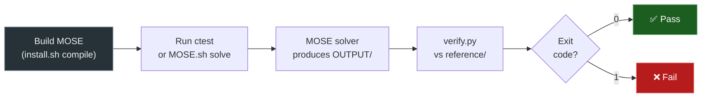

# Testing

MOSE ships with a validation test suite that exercises the solver on
canonical problems with known analytical or reference solutions.  This
page describes the test organisation, how to run tests, and how to add
new cases.

---

## Test Organisation

```
test/
├── 1D/                        # 1-D shock tube validation cases
│   ├── Sod79/
│   ├── Tor99/
│   ├── Ein91/
│   ├── Noh87/
│   └── Shu-Osher/             # Mach-3 shock / sine-wave interaction
├── fast/                      # Fast pre-push tests (hard-invariant checks)
│   ├── riemann-smoke/         # Every shock-capturing solver stays positive
│   ├── numerics-smoke/        # Limiter / time-scheme / recon / int-var sweep
│   ├── conservation/          # Closed slip-wall box conserves mass
│   ├── openmp-equiv/          # 1 vs 4 threads bit-identical
│   ├── restart/               # Restart round-trip reproduces uninterrupted run
│   ├── input-checks/          # Input checks
│   │   └── exit-codes/        # Runs stopped on an error end with a non-zero exit code and their message
│   ├── connections/           # Faces between blocks
│   │   ├── chimera-face/      # Viscous stencil of chimera faces at the edges of a block face
│   │   ├── connection-flux/   # One flux per face between blocks: one block = two blocks, conservation
│   │   └── connection-order/  # Faces between blocks of the same parity: any order of bc.txt, same bits
│   ├── time-integration/      # Time integration
│   │   ├── time-control/      # Time-dependent inlet order, time tables, stop criteria
│   │   ├── local-time-step/   # Local time step stable on square/skewed/cubic cells and in diffusive cells
│   │   ├── turbulence-sources/ # Time order and positivity of the turbulence sources; Wilcox 2006 vortex stretching; asymptotic omega wall value
│   │   └── quasi2d-symmetry/  # Quasi-2D, symmetry k faces: round-off in w does not grow
│   ├── boundary-conditions/   # Boundary conditions
│   │   └── inlets/            # Inlet boundary conditions: direction normal, total conditions
│   └── mesh-geometry/         # Mesh geometry
│       ├── wall-distance/     # Distance to the wall = exact distance to the wall surface
│       └── mesh-type/         # Plane mesh, wedge or periodic sector from every node
├── unit/                      # Unit checks of library functions, built against the library
│   └── qcr2000_check.f90      # QCR2000 stress, called as the solver calls it, against its definition
├── 2D/                        # 2-D validation cases
│   ├── euler/                 # Inviscid cases
│   │   ├── oblique-shock/
│   │   ├── prandtl-meyer/
│   │   ├── ramp-channel/
│   │   ├── hypersonic-cylinder/
│   │   ├── chang-nozzle/
│   │   ├── rocket-nozzle/     # Subdirs: frozen/ equilibrium/ finite-rate/
│   │   └── supersonic-forward-step/
│   └── viscous/               # Viscous cases
│       ├── flat-plate-laminar/
│       ├── flat-plate-turbulent/
│       ├── Flat_Plate_SGGLRR/
│       ├── mms/                   # residuals/: right-hand sides on manufactured fields (RANS, wedge)
│       ├── wedge-axis-step/       # Local time step next to the axis of the wedge (validation tier)
│       ├── point-implicit-steady/ # Steady state with the point-implicit factor independent of the time step
│       └── swbli/
├── mpi/                       # MPI tier (needs-mpi): make_case.py
│   ├── boundary-records/      # Boundary records
│   ├── connection-flux/       # Faces between ranks
│   └── connection-order/      # The 2-D case of ConnectionOrder with one block per rank
├── 3D/                        # 3-D validation cases
│   └── coriolis-channel/
├── Pressure_Centrifugal_eq/   # Rotating-frame equilibrium case
└── common/                    # Shared thermodynamic databases
    ├── Air/                   # 5-species air (dimensional)
    └── nondim-Air/            # 5-species air (non-dimensional)
```

### Categories

| Category | Location | What is checked |
|----------|----------|-----------------|
| **1-D shock tubes** | `test/1D/` | Density, velocity, pressure profiles against exact solutions (ExactPack) |
| **2-D inviscid** | `test/2D/euler/` | Converged Euler flow fields against reference data |
| **2-D viscous** | `test/2D/viscous/` | Converged Navier–Stokes / RANS solutions against reference data |
| **3-D** | `test/3D/` | 3-D flow cases |
| **Rotating frame** | `test/Pressure_Centrifugal_eq/` | Centrifugal equilibrium in a rotating reference frame |
| **Common** | `test/common/` | Shared thermodynamic databases used by multiple cases |

---

## Test Case Structure

Each test case is a self-contained directory:

```
test/1D/Sod79/
├── input.ini          # Solver input file
├── INPUT/             # Initial-condition files
├── MESH/              # Grid files
├── reference/         # Reference solution data
├── verify.py          # Comparison script (exit 0 = pass, exit 1 = fail)
└── MOSE.sh            # Run script
```

The key components are:

| File / Dir | Purpose |
|------------|---------|
| `input.ini` | Solver configuration (Riemann solver, CFL, output, ...) |
| `MESH/` | Pre-generated structured grid |
| `INPUT/` | Initial-condition field (ORION format) |
| `reference/` | Reference solution data |
| `verify.py` | Python script that compares solver output against the reference and returns exit code 0 (pass) or 1 (fail) |
| `MOSE.sh` | Convenience script to compile, run, or kill the solver |

---

## Running Tests

The validation cases are driven by **CTest** (see
[Automated Test Tiers](#automated-test-tiers-ctest--ci) below for the full
picture).  The quickest checks:

```bash
cd build

# The whole suite wired into CTest
ctest

# Just the fast pre-push tier (a few tens of seconds)
ctest -L fast

# A single case, with live output
ctest -R Sod79 -V
```

Individual cases can also be run directly from their own directory, which
is handy when iterating on a single problem.

### Single test case

2-D and 3-D cases are run individually from their own directory:

```bash
cd test/2D/euler/oblique-shock

# Compile a local MOSE binary
./MOSE.sh compile

# Run the solver
./MOSE.sh solve

# Run with OpenMP (4 threads)
./MOSE.sh -p 4 solve

# Run in background
./MOSE.sh -b solve

# Verify against reference
python3 -B verify.py
```

---

## Automated Test Tiers (CTest & CI)

The most important cases are wired into **CTest** so they can run
unattended in a Git pre-push hook and in GitHub CI.  Tiers are expressed
through CTest **labels**
(defined in [`test/CMakeLists.txt`](https://github.com/open-hydra/MOSE/blob/main/test/CMakeLists.txt)):

| Label | Meaning |
|-------|---------|
| `fast` | Tiny, dependency-free, a few seconds each — run by the pre-push hook |
| `validation` | Analytic or reference comparison |
| `numerics` / `implementation` | Coverage area (numerical scheme vs. plumbing) |
| `needs-cantera` / `needs-sundials` / `needs-mpi` | Requires the matching optional dependency; excluded from the minimal CI build |

Run a tier from the build directory:

```bash
cd build

# Everything wired into CTest
ctest

# Just the fast pre-push tier
ctest -L fast

# Everything except heavy-dependency cases (what PR CI runs)
ctest --label-exclude "needs-cantera|needs-sundials|needs-mpi"
```

### Where each tier runs

| Tier | Trigger | Selector |
|------|---------|----------|
| **Fast** | `git push` (pre-push hook, [`.githooks/pre-push`](https://github.com/open-hydra/MOSE/blob/main/.githooks/pre-push)) | `ctest -L fast` |
| **PR CI** | pull request to `main` ([`ctest.yml`](https://github.com/open-hydra/MOSE/blob/main/.github/workflows/ctest.yml)) | `ctest --label-exclude "needs-*"` |
| **Nightly / dispatch** | scheduled / manual | full suite with Cantera + Sundials + MPI |

The CI build is deliberately minimal (`USE_MPI=OFF`, `USE_TECIO=OFF`,
`USE_SUNDIALS=OFF`, `USE_CANTERA=OFF`), so finite-rate chemistry,
equilibrium, MPI and binary-Tecplot cases cannot run there — they live in
the nightly tier.

To enable the pre-push hook locally:

```bash
git config core.hooksPath .githooks
```

### Fast tier contents

The fast suite asserts **hard invariants** (positivity, conservation,
bit-for-bit reproducibility) on tiny meshes — no digitized references, no
plotting, no optional dependencies — so it stays green in a few tens of
seconds on a CI runner.

| Test | Asserts | Reuses |
|------|---------|--------|
| `Sod79` | shock/contact positions, positivity | `test/1D/Sod79` |
| `Einfeldt91`, `Noh87`, `Toro99` | profiles vs ExactPack | `test/1D/{Ein91,Noh87,Tor99}` |
| `ShuOsher` | coarse (N=200) L1 density error vs an N=1600 reference | `test/1D/Shu-Osher` |
| `PrandtlMeyer` | analytic turning angle | `test/2D/euler/prandtl-meyer` |
| `RiemannSmoke` | every shock-capturing solver stays positive (no NaN, ρ,p>0) | `test/fast/riemann-smoke` |
| `NumericsSmoke` | all limiters × time schemes × recon × integration vars stay positive | `test/fast/numerics-smoke` |
| `BoundaryConditions`/`Inlets` | an ambient inlet (407) with the flow direction `normal` gives the field of the angles the token stands for on that face, to the bit, with no transverse velocity | `test/fast/boundary-conditions/inlets` |
| `TimeIntegration`/`TimeControl` | second order in time with a time-dependent inlet (BC 402) for RK2 and RK3; a time table holds its first value before its first instant; `res-threshold` does not end a time-accurate run | `test/fast/time-integration/time-control` |
| `Conservation` | closed slip-wall box conserves total mass to round-off | `test/fast/conservation` |
| `OpenMPEquiv` | 1 vs 4 threads bit-identical: the Sod tube, and a block overset on another whose four chimera faces meet at its edges (Navier–Stokes) | `test/fast/openmp-equiv` |
| `Connections`/`ChimeraFace` | the viscous stencil of chimera faces, one evaluation of the residual of a linear field on two blocks that overlap with their ghost cells on cells of the other block: with u = G y in 2-D and u = G (y + z) in 3-D the y and z momentum residual is zero also in the cells at the ends of the chimera faces; with a radial velocity on a 2-D wedge of 1 degree the momentum residual of every cell is that of the same mesh as one block (within 1e-9 of μ G / H) | `test/fast/connections/chimera-face` |
| `Restart` | split + restart reproduces the uninterrupted run; at a restart a missing probe file is written again and an existing one is appended to, with the rows of the uninterrupted run | `test/fast/restart` |
| `InputChecks`/`ExitCodes` | a run stopped on an error ends with a non-zero exit code and its message and writes no solution: the Sod tube as a viscous mixture of four species, without `schmidt` and `diffusion.dat`, stops at setup; so does a run with a probe of an unknown variable, with exit status 1 and the name of the variable; a steady run with a soot model, with and without Spalart–Allmaras, ends normally and its diagnostic output names every variable it writes; the same state with `turbulence = SAcomp` stops at set-up with the message (a correction whose result depends on the units); a steady single-species run with sol-variables = none stops with a message that names thermo or transport | `test/fast/input-checks/exit-codes` |
| `TimeIntegration`/`Quasi2DSymmetry` | quasi-2D case with symmetry k faces: p, u, v stay uniform and round-off in w does not grow (Heun, RK3); the same in a 1-D tube with symmetry j and k faces for v and w; a channel of variable section in a layer between parallel planes inclined to z and a 1-D channel of variable section keep the velocity across, with the warning, and p within 0.03 p0 of the quasi-1-D flow | `test/fast/time-integration/quasi2d-symmetry` |
| `TimeIntegration`/`LocalTimeStep` | the step is stable at cfl 0.8 on square and on skewed 2-D cells and on cubic 3-D cells, in diffusion-dominated cells set by heat conduction and by species diffusion with the default cfl and vnn (Heun, RK3), and in the 1-D shock tube at cfl 0.99; on a periodic block of 8³ rhombohedra with every edge angle at 115°, where the viscous operator exceeds the rate 4 D sum_d |grad xi_d|^2 by 1.0365, heat conduction with Heun at vnn 0.5 decays over 600 steps | `test/fast/time-integration/local-time-step` |
| `QCR2000Stress` | the quadratic constitutive relation QCR2000, called as the solver calls the stress (laminar viscosity, then eddy viscosity) on a 3-D velocity gradient, gives tau_QCR · n of the definition with the eddy viscosity alone and the laminar stress with the laminar viscosity alone | `test/unit/qcr2000_check.f90` |
| `TimeIntegration`/`TurbulenceSources` | in time-accurate runs with Spalart–Allmaras and SST, nu~, k and omega converge in time with the order of Heun (≥ 1.8) and RK3 (≥ 2.7), and no stage makes them negative when near-wall turbulence decays faster than the transport acts; a time-accurate SST-RC run with no cfl-rise-threshold prints both the k-omega and the -RC start-up warnings; with Wilcox 2006, one step of a 3-D linear flow changes rho omega by the source with the vortex-stretching function f_beta of the specification, chi_w = W_ij W_jk S^_ki/(beta* omega)^3 with the off-diagonal part of S^; with omega-wall-bc = asymptotic, a channel at rest whose omega is the wall value 6 nu/(beta d^2) of the model (beta_0 for Wilcox 2006, beta_1 for SST) changes rho omega in the wall cells by the destruction alone | `test/fast/time-integration/turbulence-sources` |
| `MMSResiduals` | on a constructed field with variable density and nu~, the right-hand side of the equation for rho nu~ converges with second order to the standard conservation form of Spalart–Allmaras; with SA-RC and SST-RC, the change of rho nu~ (rho k and rho omega) in one step of a 3-D flow with vorticity along x, y and z is the same as for the flow turned in space (x to y, y to z, z to x), cell by cell: the rotation tensor W_ij = (∂u_i/∂x_j − ∂u_j/∂x_i)/2 is a tensor; with SA-RC in a frame turning about z, a uniform shear changes rho nu~ by the production with the f_r1 of the specification, whose r~ takes the rotation of the frame, and a uniform flow, whose vorticity is zero, runs and keeps rho nu~; on air at rest next to a wall, and off the wall row of air flowing along it on cells stretched along the flow, SA-RC changes rho nu~ as SA does; on Homann's axisymmetric stagnation-point flow and on a polynomial field with dilatation and swirl (2-D wedge of 1°, axis included) the viscous force converges with second order to the Navier–Stokes one, the stress on the wedge faces included; with nu~ = a y over a wall, fluid at rest (an equilibrium of the equation for chi -> 0), the right-hand side of rho nu~ vanishes in the wall cells too, where the source terms must see grad nu~ = a from the wall value nu~ = 0 | `test/2D/viscous/mms/residuals` |
| `Connections`/`ConnectionFlux` | a periodic shock tube as one block and as two blocks gives the same bits, and conserves mass, momentum and energy to 1e-13, with HLLC, HLLC+Tramel, HLLC+Chen (shock sensor) and HLLC-PC (preconditioned, on a low Mach number wave) | `test/fast/connections/connection-flux` |
| `Connections`/`ConnectionOrder` | two 2-D blocks whose index directions are permuted across the cut (face 4 of one on face 2 of the other, two faces of the same parity) give the same bits with the records of `bc.txt` sorted and reversed (Navier–Stokes, HLLC+Tramel, a shock leaving the cut); with the block below the cut one cell thick across it, or two cells thick with two multigrid levels (one at level 2), the run stops at set-up with a message that names the record, the block across, its cells and the level | `test/fast/connections/connection-order` |
| `MeshGeometry`/`WallDistance` | the distance to the wall read back from the Spalart–Allmaras source is the exact distance to the wall surface (convex corner, curved wall, nozzle lip on a wedge), and to its periodic images (channel and pipe periodic in x, 3-D sector, the channel with its periodic sides matched to 1e-8, 3-D slab periodic in k); on a 3-D wall of twisted faces, the start-up report of the bound of the error | `test/fast/mesh-geometry/wall-distance` |
| `MeshGeometry`/`MeshType` | a plane slab is plane and a wedge is a wedge whatever the direction of j (wall distance within 1e-9), also a wedge of 5 degrees in two blocks written with 5 significant digits and a plane slab far from the x axis, which a small turn nearly fits; the set-up summary names the type; a wedge written with 2 significant digits, too few to tell it, a plane slab whose k planes are not parallel (2 % of its thickness), 3-D sectors of 90 degrees whose periodic plane misses the turn by half a cell (100 cells in k) or a tenth (20 cells), and a wedge block with a plane block stop the run; a 3-D slab periodic in k keeps a uniform flow within 1e-12 | `test/fast/mesh-geometry/mesh-type` |

A few heavier checks carry the `validation` (not `fast`) label because they
need reference data or plotting — for example `ShuOsherConvergence`, a 4-grid
Shu–Osher Richardson study (N=200/400/800/1600) that estimates a grid-independent
solution by Richardson extrapolation, asserts a sane observed order and monotone
L1 convergence against it, and regenerates the V&V figure. `PointImplicitSteady`
(`test/2D/viscous/point-implicit-steady`) is there for its
cost, 14 000 iterations per model: the steady state of a short hypersonic plate
with the point-implicit factor (Spalart–Allmaras, SST) does not depend on the
time step, and implicit residual smoothing does not move it either (wall shear
and heat flux to 1e-9). `WedgeAxisStep`
(`test/2D/viscous/wedge-axis-step`) is there for its cost too, eight runs of
2000 iterations (~155 s of CPU): on a diffusion-dominated 1° wedge (Prandtl number 10) the local time
step keeps the rows next to the axis stable at the largest vnn the rule
declares, RK3 0.62 and Heun 0.5, on square cells, on cells twice as long in x
and with the axis on the last j face, and at the recommended vnn, RK3 0.5 and
Heun 0.4, on cells four times as long in x with the Prandtl number of air and
with 0.9.
Run them with `ctest -L validation`.

### MPI tier contents

Builds with `USE_MPI=ON` also register a `needs-mpi` tier. Each test generates
its own small multi-block case, launches the solver itself through the MPI
launcher CMake found (`MPIEXEC_EXECUTABLE`, at most 4 ranks) and asserts
**bit-for-bit** invariants of the parallel solution.

| Test | Asserts | Lives in |
|------|---------|----------|
| `MPIBoundaryRecords` | a strip of four viscous blocks (inlet, outlet, wall, symmetry and block-cut records) gives the same solution on 1×1, 2×1, 4×1 and 2×2 (MPI ranks × OpenMP threads); the same case with the `bc.txt` records in reverse order gives the same solution and the same wall output (Tecplot) as the ordered file, on 1 and 2 ranks, with and without threads; and so does a Spalart–Allmaras run, ordered and reversed (1×1, 1×4, 2×2) | `test/mpi/boundary-records` |
| `MPIConnectionFlux` | the two-block cases of `Connections`/`ConnectionFlux` with one block per rank (block cut and periodic connection between ranks) give the one-rank and the one-block solutions bit for bit, and conserve | `test/mpi/connection-flux` |
| `MPIConnectionOrder` | the 2-D case of `Connections`/`ConnectionOrder` with one block per rank (the cut, inviscid and viscous shares, between ranks): 2 ranks with the records of `bc.txt` sorted and reversed give the one-rank solution bit for bit | `test/mpi/connection-order` |

Run the tier from the build directory of an MPI build:

```bash
ctest -L needs-mpi --output-on-failure
```

The broader plan — coverage map, remaining gaps, and the rationale behind
the tiering — lives in
[`test/TESTING-PLAN.md`](https://github.com/open-hydra/MOSE/blob/main/test/TESTING-PLAN.md).

---

## Test Workflow Diagram



---

## Adding a New Test Case

### 1-D shock tube

1. Create a directory under `test/1D/` (e.g. `test/1D/MyCase/`).
2. Provide `input.ini`, `MESH/`, and `INPUT/` with the problem setup.
3. Run the solver to generate a reference solution.
4. Save the reference data in `reference/` and write a `verify.py` that:
    - Reads the solver output
    - Reads the reference data
    - Compares key quantities (density, velocity, pressure) within tolerance
    - Calls `sys.exit(0)` on success, `sys.exit(1)` on failure
5. Copy `MOSE.sh` from an existing case (it is generic).

### 2-D / 3-D case

Same structure. Place the directory under the appropriate folder in
`test/2D/euler/`, `test/2D/viscous/`, or `test/3D/`.  Multi-chemistry
cases (e.g. `rocket-nozzle`) may use subdirectories for each chemistry
level (`frozen/`, `equilibrium/`, `finite-rate/`) with a shared
`verify.py` at the parent level.

### Wiring a case into CTest

A case is only run by the pre-push hook and CI once it is registered in
[`test/CMakeLists.txt`](https://github.com/open-hydra/MOSE/blob/main/test/CMakeLists.txt).
Two helpers are available:

```cmake
# A case with a run command + a Python verifier (exit 0/1)
mose_add_test(NAME MyCase DIR 1D/MyCase
              RUN "./MOSE.sh solve" VERIFY verify.py
              LABELS "fast;validation;1D")

# A self-contained fast test driven by its own run.sh
mose_add_fast_script(MySmoke fast/my-smoke "fast;numerics;1D")
```

Add the `fast` label only if the case runs in a few seconds on a tiny mesh
and asserts a hard invariant — anything needing Cantera, Sundials or MPI
must instead carry the matching `needs-*` label so it is excluded from the
minimal CI build.

---

## Common Thermodynamic Data

The `test/common/` directory contains shared species databases:

| Directory | Content |
|-----------|---------|
| `Air/` | 5-species air (N₂, O₂, NO, N, O) with dimensional transport |
| `nondim-Air/` | Same mixture in non-dimensional form |

Test cases symlink to these files rather than duplicating them.

---

## Reference Solution Generation

The 1-D reference solutions are generated using
[ExactPack](https://github.com/lanl/ExactPack), which provides exact
Riemann-problem solvers for canonical test cases (Sod, Toro, Einfeldt,
Noh, etc.).

ExactPack is not on PyPI and is no longer carried as a submodule; install
it from LANL's GitHub, pinned to the tag CI uses:

```bash
pip install "ExactPack @ git+https://github.com/lanl/ExactPack.git@1.7.11"
```

The `verify.py` scripts use ExactPack to compute the exact solution
on the same grid and compare point-by-point.
