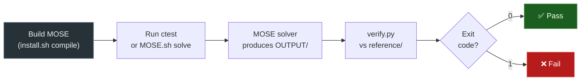

# Testing

MOSE ships with a validation test suite that exercises the solver on
canonical problems with known analytical or reference solutions.  This
page describes the test organisation, how to run tests, and how to add
new cases.

---

## Test Organisation

```
test/
├── 1D/                        # 1-D shock tube validation cases
│   ├── Sod79/
│   ├── Tor99/
│   ├── Ein91/
│   ├── Noh87/
│   ├── Shu-Osher/             # Mach-3 shock / sine-wave interaction
│   ├── Fer14/                 # Finite-rate reactive shock tube
│   ├── diff1/                 # Unity-Lewis diffusion
│   ├── diff2/                 # Multicomponent diffusion
│   └── premixed-flame/        # Premixed CH4/air laminar flame against a Cantera reference
├── fast/                      # Fast pre-push tests (hard-invariant checks)
│   ├── riemann-smoke/         # Every shock-capturing solver stays positive
│   ├── numerics-smoke/        # Limiter / time-scheme / recon / int-var sweep
│   ├── conservation/          # Closed slip-wall box conserves mass
│   ├── openmp-equiv/          # 1 vs 4 threads bit-identical
│   ├── restart/               # Restart round-trip reproduces uninterrupted run
│   │   └── restart-counters/  # Restarts carry on iteration, output and level counters
│   ├── input-checks/          # Input checks
│   │   ├── exit-codes/        # Runs stopped on an error end with a non-zero exit code and their message, valid runs with 0
│   │   ├── limiter-defaults/  # The reconstruction that runs is the declared one
│   │   ├── irs-time-accurate/ # Residual smoothing refused in time-accurate runs
│   │   ├── decomposition-map/ # Block-to-rank map on one rank: same bits, misfit maps stop
│   │   └── runtime-input/     # input.ini read again during a run: the rules apply, the keys left out keep their values
│   ├── connections/           # Faces between blocks
│   │   ├── chimera-face/      # Viscous stencil of chimera faces at the edges of a block face
│   │   ├── connection-flux/   # One flux per face between blocks: one block = two blocks, conservation
│   │   ├── connection-order/  # Faces between blocks of the same parity: any order of bc.txt, same bits
│   │   ├── sector-radial/     # A 3-D sector closed by type 200 keeps a radial flow mirror-symmetric
│   │   └── sector-viscous/    # The k faces of a 3-D sector closed by type 200 carry the viscous flux, exact for linear fields; type 200 joins the two k faces of one block
│   ├── time-integration/      # Time integration
│   │   ├── time-control/      # Time-dependent inlet order, time tables, stop criteria
│   │   ├── local-time-step/   # Local time step stable on square/skewed/cubic cells and in diffusive cells
│   │   ├── turbulence-sources/ # Time order and positivity of the turbulence sources; Wilcox 2006 vortex stretching; asymptotic omega wall value
│   │   └── quasi2d-symmetry/  # Quasi-2D, symmetry k faces: round-off in w does not grow
│   ├── boundary-conditions/   # Boundary conditions
│   │   ├── inlets/            # Inlet boundary conditions: direction normal, total conditions
│   │   ├── bc-input/          # Property lines of bc.txt read as written or refused
│   │   ├── rotating-frame/    # Rotating frame: stationary faces read and listed; a stationary wall in the wall output
│   │   └── wall-heat-sign/    # q_wall, qw and the wall stress are oriented into the gas on every face
│   ├── mesh-geometry/         # Mesh geometry
│   │   ├── wall-distance/     # Distance to the wall = exact distance to the wall surface
│   │   └── mesh-type/         # Plane mesh, wedge or periodic sector from every node
│   ├── output-files/          # Output files
│   │   ├── wall-output/       # Wall output in vtk raw: every wall file has the extent, the points and the cell values of its face
│   │   ├── vtk-names/         # Names and times of the VTK outputs
│   │   ├── vtk-raw-format/    # vtk raw outputs hold raw appended data
│   │   ├── wall-output-residual/ # The wall output leaves the residual of the wall cells alone
│   │   └── probe-position/    # Probes given by position record the cell that holds them
│   └── viscous-patch/         # Patch test of the viscous fluxes
│       ├── viscous-linear-patch/ # Patch test of the viscous fluxes: linear fields on skewed, folded, 3- and 5-block meshes
│       ├── viscous-open-patch/ # The same patch test next to inlets and outlets (401-408, 420)
│       └── viscous-wall-patch/ # The same patch test next to walls of prescribed temperature (302) and faces of type 410
├── unit/                      # Unit checks of library functions, built against the library
│   ├── bilinear_distance_cases.py # cases of BilinearDistance and their exact references (writes the .txt)
│   ├── bilinear_distance_cases.txt # the cases, every coordinate and reference exact
│   ├── bilinear_distance_check.f90 # wall distance to a bilinear face, and the fast-path test, against exact values
│   ├── bilinear_distance_exact.py # exact distance to a bilinear face: stationarity equations, rational arithmetic
│   ├── cell_volume_check.f90  # volume of a cell against the exact integral of det J; inverted cell flagged
│   ├── cell_volume_exact.py   # exact volumes of its cells, in rational arithmetic (prints its data block)
│   ├── qcr2000_check.f90      # QCR2000 stress, called as the solver calls it, against its definition
│   └── volatile_order_check.f90 # a difference read back from a VOLATILE variable is rounded as written
├── 2D/                        # 2-D validation cases
│   ├── euler/                 # Inviscid cases
│   │   ├── oblique-shock/
│   │   ├── prandtl-meyer/
│   │   ├── ramp-channel/
│   │   ├── hypersonic-cylinder/
│   │   ├── chang-nozzle/
│   │   ├── rocket-nozzle/     # Subdirs: frozen/ equilibrium/ finite-rate/
│   │   ├── supersonic-forward-step/
│   │   ├── gresho-vortex/     # Low-Mach Gresho vortex
│   │   └── isentropic-vortex/ # Isentropic vortex convection (N1): order of accuracy on 32/64/128 grids
│   └── viscous/               # Viscous cases
│       ├── flat-plate-laminar/
│       ├── flat-plate-turbulent/  # Subdirs: SA/ SST/ Wilcox2006/
│       ├── ablating-wall/     # Ablative wall BCs (503 melting / 504 pyrolysis): an isothermal blown column
│       ├── mms/                   # residuals/: right-hand sides on manufactured fields (RANS, wedge); skewed/: order on skewed grids (validation tier)
│       ├── wedge-axis-step/       # Local time step next to the axis of the wedge (validation tier)
│       ├── point-implicit-steady/ # Steady state with the point-implicit factor independent of the time step
│       ├── planar-nozzle/         # RANS nozzle on grid families: mirror symmetry whatever the index orientation (validation tier)
│       └── swbli/
├── mpi/                       # MPI tier (needs-mpi): make_case.py, write_map.py
│   ├── boundary-records/      # Boundary records
│   ├── connection-flux/       # Faces between ranks
│   ├── connection-order/      # The 2-D case of ConnectionOrder with one block per rank
│   ├── vertex-stencil/        # Viscous connection stencil at a vertex shared by four blocks
│   ├── thread-funnel/         # MPI calls only from the main thread (MPI_THREAD_FUNNELED)
│   ├── decomposition-map/     # Block-to-rank maps on 2 and 4 ranks: the one-rank field
│   ├── exit-codes/            # An input error on rank 0, also one read again during the run, stops both ranks of a 2-rank run
│   ├── runtime-input/         # input.ini read again: every rank takes the text that rank 0 reads (two folders, MPMD)
│   ├── restart/               # Exact restart from vtk raw on 2 ranks x 2 threads
│   └── bit-identity/          # The same output bits on 1x1, 1x4, 2x1, 4x1 and 2x2 ranks x threads
├── 3D/                        # 3-D validation cases
│   ├── coriolis-channel/
│   ├── viscous/
│   │   └── mms/               # Manufactured solution on skewed 3-D grids (validation tier)
│   ├── hyshotII/              # HyShot II scramjet combustor
│   └── pressure-centrifugal/  # Rotating-frame equilibrium case
└── common/                    # Shared thermodynamic databases
    ├── Air/                   # 5-species air (dimensional)
    ├── nondim-Air/            # 5-species air (non-dimensional)
    ├── Air-sutherland/        # Transport table of air: viscosity and conductivity
    └── Air-viscous/           # One-species air: phase, thermodynamic and transport tables
```

### Categories

| Category | Location | What is checked |
|----------|----------|-----------------|
| **1-D shock tubes** | `test/1D/` | Density, velocity, pressure profiles against exact solutions (ExactPack) |
| **2-D inviscid** | `test/2D/euler/` | Converged Euler flow fields against reference data |
| **2-D viscous** | `test/2D/viscous/` | Converged Navier–Stokes / RANS solutions against reference data |
| **3-D** | `test/3D/` | 3-D flow cases |
| **Rotating frame** | `test/3D/pressure-centrifugal/` | Centrifugal equilibrium in a rotating reference frame |
| **Common** | `test/common/` | Shared thermodynamic databases used by multiple cases |

---

## Test Case Structure

Each test case is a self-contained directory:

```
test/1D/Sod79/
├── input.ini          # Solver input file
├── INPUT/             # Initial-condition files
├── MESH/              # Grid files
├── reference/         # Reference solution data
├── verify.py          # Comparison script (exit 0 = pass, exit 1 = fail)
└── MOSE.sh            # Run script
```

The key components are:

| File / Dir | Purpose |
|------------|---------|
| `input.ini` | Solver configuration (Riemann solver, CFL, output, ...) |
| `MESH/` | Pre-generated structured grid |
| `INPUT/` | Initial-condition field (ORION format) |
| `reference/` | Reference solution data |
| `verify.py` | Python script that compares solver output against the reference and returns exit code 0 (pass) or 1 (fail) |
| `MOSE.sh` | Convenience script to compile, run, or kill the solver |

---

## Running Tests

The validation cases are driven by **CTest** (see
[Automated Test Tiers](#automated-test-tiers-ctest-and-ci) below for the full
picture).  The quickest checks:

```bash
cd build

# The whole suite wired into CTest, but the full forms of the verification
# cases (label verification: hours or days at one thread)
ctest -LE verification

# Just the fast pre-push tier (about two minutes of CPU time at one thread)
ctest -L fast

# A single case, with live output
ctest -R Sod79 -V
```

Individual cases can also be run directly from their own directory, which
is handy when iterating on a single problem.

### Single test case

2-D and 3-D cases are run individually from their own directory:

```bash
cd test/2D/euler/oblique-shock

# Compile a local MOSE binary
./MOSE.sh compile

# Run the solver
./MOSE.sh solve

# Run with OpenMP (4 threads)
./MOSE.sh -p 4 solve

# Run in background
./MOSE.sh -b solve

# Verify against reference
python3 -B verify.py
```

---

## Automated Test Tiers (CTest and CI)

The most important cases are wired into **CTest** so they can run
unattended in a Git pre-push hook and in GitHub CI.  Tiers are expressed
through CTest **labels**
(defined in [`test/CMakeLists.txt`](https://github.com/open-hydra/MOSE/blob/main/test/CMakeLists.txt)):

| Label | Meaning |
|-------|---------|
| `fast` | Tiny, dependency-free, a few seconds each — run by the pre-push hook |
| `validation` | Analytic or reference comparison |
| `numerics` / `implementation` | Coverage area (numerical scheme vs. plumbing) |
| `needs-cantera` / `needs-sundials` / `needs-mpi` | Requires the matching optional dependency; excluded from the minimal CI build |
| `verification` | Full form of a verification case (families of grids, long runs), whose short form runs in the `validation` tier; run on request with `ctest -L verification`, excluded from the PR CI |

Run a tier from the build directory:

```bash
cd build

# Everything wired into CTest, but the full forms of the verification cases
ctest -LE verification

# Just the fast pre-push tier
ctest -L fast

# Everything except heavy-dependency cases and the full forms of the
# verification cases (what the first job of PR CI runs)
ctest --label-exclude "needs-cantera|needs-sundials|needs-mpi|verification"

# The full forms of the verification cases
ctest -L verification
```

### Where each tier runs

| Tier | Trigger | Selector |
|------|---------|----------|
| **Fast** | `git push` (pre-push hook, [`.githooks/pre-push`](https://github.com/open-hydra/MOSE/blob/main/.githooks/pre-push)) | `ctest -L fast` |
| **PR CI** | pull request to `main` ([`ctest.yml`](https://github.com/open-hydra/MOSE/blob/main/.github/workflows/ctest.yml)) | `ctest --label-exclude` the `needs-*` labels and `verification`; in a second job built with MPI, `ctest -L needs-mpi` |
| **Nightly / dispatch** | scheduled / manual | full suite with Cantera + Sundials + MPI, and the full forms of the verification cases |

The first CI job builds MOSE deliberately minimal (`USE_MPI=OFF`, `USE_TECIO=OFF`,
`USE_SUNDIALS=OFF`, `USE_CANTERA=OFF`), so finite-rate chemistry,
equilibrium and binary-Tecplot cases cannot run there — they live in
the nightly tier. The second job, `test-mpi`, builds MOSE with gfortran, the
Open MPI of Ubuntu and `USE_MPI=ON`, and runs the `needs-mpi` tier; it fails
when the tier holds no test (`--no-tests=error`).

To enable the pre-push hook locally:

```bash
git config core.hooksPath .githooks
```

### Fast tier contents

The fast suite asserts **hard invariants** (positivity, conservation,
bit-for-bit reproducibility) on tiny meshes — no digitized references, no
plotting, no optional dependencies. Each of its parts takes about 10 s of CPU
time or less at one thread in the build of the first CI job, the rule of a row
of the [test plan](https://github.com/open-hydra/MOSE/blob/main/test/TESTING-PLAN.md)
(section 4, with its tolerance and the conditions of the measurements), and the
tier about 120 s in all. Three parts of these areas take more and run in the
`validation` tier under their own names, `ExitCodes`, `RuntimeInput` (both in
`test/fast/input-checks`) and `ViscousWallPatch` (`test/fast/viscous-patch`);
their rows stay in the table, marked *(validation)*.

| Test | Asserts | Reuses |
|------|---------|--------|
| `Sod79` | shock/contact positions, positivity | `test/1D/Sod79` |
| `Einfeldt91`, `Noh87`, `Toro99` | profiles vs ExactPack | `test/1D/{Ein91,Noh87,Tor99}` |
| `ShuOsher` | coarse (N=200) L1 density error vs an N=1600 reference | `test/1D/Shu-Osher` |
| `PrandtlMeyer` | analytic turning angle | `test/2D/euler/prandtl-meyer` |
| `RiemannSmoke` | every shock-capturing solver stays positive (no NaN, ρ,p>0); with shock-detector = Tramel the set-up summary names the shock sensor, with HLLC and with HLLC+Tramel, which gives the field of the run without the key | `test/fast/riemann-smoke` |
| `NumericsSmoke` | all limiters × time schemes × recon × integration vars stay positive | `test/fast/numerics-smoke` |
| `InputChecks`/`LimiterDefaults` | MUSCL without `flux-limiter` runs van Leer and first-order ignores a given limiter (fields bit-identical to the explicit settings), with the matching set-up warnings and summary | `test/fast/input-checks/limiter-defaults` |
| `InputChecks`/`IRSTimeAccurate` | a time-accurate run with implicit residual smoothing (`irs = true` or `irs-beta > 0`) is refused at set-up; steady runs keep it | `test/fast/input-checks/irs-time-accurate` |
| `BoundaryConditions`/`Inlets` | an ambient inlet (407) with the flow direction `normal` takes the angles of its face, to the bit; on a 1-D tube of air, one forward Euler step, the inlets at total conditions (401, 407) give the mass flux of their face state within 1e-9 of rho a in every regime: subsonic, choked, a reservoir that cannot feed the face (a slip wall, or an outlet at p_back), the gas of the cell moving in at 2a/(γ−1) or faster (choked or subsonic), and the invariant a + (γ−1)/2 w on either side of zero, where the mass flux is continuous | `test/fast/boundary-conditions/inlets` |
| `TimeIntegration`/`TimeControl` | second order in time with a time-dependent inlet (BC 402) for RK2 and RK3; a time table holds its first value before its first instant; `res-threshold` does not end a time-accurate run, and ends a steady run when the density residual has fallen by that factor from the first iteration: a 1-D tube of air at Mach 2 that carries an entropy wave out ends at the same iteration at 1 bar and at 1 bar × 2⁻²⁴ (an exact scaling of the Euler equations), and so does the run at 1 bar restarted from `vtk raw` after 60 iterations | `test/fast/time-integration/time-control` |
| `Conservation` | closed slip-wall box conserves total mass to round-off | `test/fast/conservation` |
| `BoundaryConditions`/`RotatingFrame` | a rigid-body rotating frame with two `stationary-face-<n>` entries, the walls at the two ends of a Sod tube: the run ends within 60 s with exit code 0 and its set-up summary lists the two stationary patches; one on a face of type 400 (no wall 301 or 302), or on a block the mesh does not have, stops the run at set-up with a non-zero exit code and the message; a viscous tube turning about x with the gas at rest in the absolute frame and a stationary wall across the axis: the wall output reports a shear below 1e-3 of mu Omega y_c / (dx/2), the shear of the same wall taken as rotating; the same tube two cells across, its face across the axis a wall 302 for one cell and a block connection (101) to a second block for the other: the face can be stationary, the run ends with exit code 0, lists the patch and keeps the shear of the wall part below 1e-3 of the same scale; with a symmetry plane (300) in place of the connection the run stops at set-up with the message | `test/fast/boundary-conditions/rotating-frame` |
| `OpenMPEquiv` | 1 vs 4 threads bit-identical: the Sod tube, and a block overset on another whose four chimera faces meet at its edges (Navier–Stokes) | `test/fast/openmp-equiv` |
| `Connections`/`ChimeraFace` | the viscous stencil of chimera faces, one evaluation of the residual of a linear field on two blocks that overlap with their ghost cells on cells of the other block: with u = G y in 2-D and u = G (y + z) in 3-D the y and z momentum residual is zero also in the cells at the ends of the chimera faces; with a radial velocity on a 2-D wedge of 1 degree the momentum residual of every cell is that of the same mesh as one block (within 1e-9 of μ G / H); a chimera face whose first layer of extrapolated ghost cells is turned over (the y spacing growing 4 times across the last cell) stops the run at set-up, as its viscous flux takes their metric | `test/fast/connections/chimera-face` |
| `Restart` | split + restart reproduces the uninterrupted run; at a restart a missing probe file is written again and an existing one is appended to, with the rows of the uninterrupted run: to the precision of the file with Tecplot ASCII, bit for bit with `vtk raw`, iteration counters and output numbering included; a restart from a solution that holds no time (Tecplot ASCII without `SOLUTIONTIME`, `vtk raw` without `TIME`), time-accurate or steady, stops at setup with a message and a non-zero exit code; a solution written in `vtk raw`, `vtk ascii` and Tecplot ASCII, copied into `INPUT/` (`field.vtm` with its `vtk/` folder, `field.tec`), starts a new run whose cell values after 25 steps are those of the restart from the same solution, bit for bit | `test/fast/restart` |
| `AblatingWall` | the ablative wall boundary conditions (503 melting, 504 pyrolysis) on an isothermal blown column, an exact steady solution, against its closed form; the melting column also without `schmidt` | `test/2D/viscous/ablating-wall` |
| `OutputFiles`/`WallOutput` | a vtk raw run of a 2x2-block box with no-slip walls on its four sides ends, and every wall file `wallB<b>F<f>.vts` has the extent of its face, taken from `fieldBlock<b>.vts`, as WholeExtent and as Piece Extent, its points and one value of each wall variable per cell (a direction with one plane of nodes counts one layer of cells, as in the cell-centered ordered data of the Tecplot format), as raw appended data; `OUTPUT/wall.vtm` lists the 8 wall files, one for each wall face, all written, and no other wall file is there | `test/fast/output-files/wall-output` |
| `Restart`/`RestartCounters` | a restart writes the files of the uninterrupted run, byte for byte: with `vtk raw` and from Tecplot ASCII, steady and time-based outputs, the CFL ramp, probes, two multigrid levels, the rotating frame (`torque.dat`), history files cut by hand, a first part that ends on an output iteration; a time-accurate restart from a steady solution starts at t = 0 | `test/fast/restart/restart-counters` |
| `OutputFiles`/`ProbePosition` | probes given by position at the centres of three cells of a planar 2-D duct (one cell in k, a different pressure in every cell, two steps): each probe row holds the values of its cell in the solution of the same step, never those of a neighbour or of a ghost cell | `test/fast/output-files/probe-position` |
| `OutputFiles`/`VtkNames` | field, wall and diagnostic `vtk raw` outputs of a steady viscous run are well-formed XML and name their arrays after the variables MOSE writes; the three outputs carry the same solution time, minus the global iteration count, in `vtk raw`, `vtk ascii` (field data `TIME`, with `CYCLE` in the field) and Tecplot ASCII (`SOLUTIONTIME` of every zone, no `STRANDID`) | `test/fast/output-files/vtk-names` |
| `RuntimeInput` *(validation)* | `input.ini` read again during the run: a value out of its rule (`cfl = -1`) stops the run with the message of the rule, at setup and at the next reading; with the required keys only, or with `integration-variables`, `riemann-solver` and `flux-limiter` written, the run gives the residual history of the run without readings; a comment line with "=" is skipped; in a rotating frame a new `omega` acts from its reading as a restart would, byte for byte, a change of `rotational-frame`, of the stationary faces or a NaN `axis` stops the run, and the stationary-face keys left out keep their faces | `test/fast/input-checks/runtime-input` |
| `OutputFiles`/`VtkRawFormat` | with `sol-format = vtk raw`, every block file of the field and diagnostic outputs of a steady and of a time-accurate run holds raw appended data, before and after the first diagnostic output | `test/fast/output-files/vtk-raw-format` |
| `ExitCodes` *(validation)* | a run stopped on an error ends with a non-zero exit code and its message, and writes no solution: errors of `input.ini` (a file that cannot be read, values that do not read or break their rules), of the initial condition and of a restart file (too few variables, values that are not finite), of `bc.txt` and of the files of `402` and `410`, of the probes, of the rotating frame, of the chemistry and diffusion inputs, of `exclude-blocks`, and a divergence; a soot run names every variable of its diagnostic output; a block excluded from chemistry keeps the bits of the run without chemistry, and a valid run with `exclude-blocks` ends with 0 (the cases: `test/TESTING-PLAN.md`, row I9, and the `run.sh` of the test) | `test/fast/input-checks/exit-codes` |
| `TimeIntegration`/`Quasi2DSymmetry` | quasi-2D case with symmetry k faces: p, u, v stay uniform and round-off in w does not grow (Heun, RK3); the same in a 1-D tube with symmetry j and k faces for v and w; a channel of variable section in a layer between parallel planes inclined to z and a 1-D channel of variable section keep the velocity across, with the warning, and p within 0.03 p0 of the quasi-1-D flow | `test/fast/time-integration/quasi2d-symmetry` |
| `TimeIntegration`/`LocalTimeStep` | the step is stable at cfl 0.8 on square and on skewed 2-D cells and on cubic 3-D cells, in diffusion-dominated cells set by heat conduction and by species diffusion with the default cfl and vnn (Heun, RK3), and in the 1-D shock tube at cfl 0.99; on a periodic block of 8³ rhombohedra with every edge angle at 115°, where the viscous operator exceeds the rate 4 D sum_d |grad xi_d|^2 by 1.0365, heat conduction with Heun at vnn 0.5 decays over 600 steps; with `integration-variables = prec`, next to a wall with SST and Wilcox 2006, the step takes the reference velocity of the viscous floor with the eddy viscosity of the model at the strain rate of the cell | `test/fast/time-integration/local-time-step` |
| `QCR2000Stress` | the quadratic constitutive relation QCR2000, called as the solver calls the stress (laminar viscosity, then eddy viscosity) on a 3-D velocity gradient, gives tau_QCR · n of the definition with the eddy viscosity alone and the laminar stress with the laminar viscosity alone | `test/unit/qcr2000_check.f90` |
| `CellVolume` | the volume of a cell is the integral of det J of the trilinear cell, within 32 u (u = 2⁻⁵³) of its exact value in rational arithmetic: cubes with one twisted face (T_n/h = 1 and 5), a valid non-convex cell with six twisted faces, a cell with a collapsed edge, a 2-D prism, wedge cells of 5° (one on the axis), the first cube and the prism moved by 1e3, the first cube mirrored (left-handed, stored positive); on a twisted mesh of 8³ cells the volumes sum to the volume enclosed by the boundary faces within 1e-13; a cell whose volume has not the sign of det A at its centre raises the flag of degenerate or inverted cells | `test/unit/cell_volume_check.f90` (exact values: `test/unit/cell_volume_exact.py`) |
| `VolatileOrder` | a difference stored in a `VOLATILE` variable and read back is rounded as written, also with `-ffast-math`: (q − c1) − (c2 − c1) with q = 1, c1 = 2⁵⁴, c2 = 3, read from the command line, gives −4, the order of the source, and not q − c2 = −2, which the release flags of gfortran 13 and ifx 2024.1 give through plain variables (printed, not asserted) | `test/unit/volatile_order_check.f90` |
| `BilinearDistance` | the certified minimum of the wall distance to a bilinear face against the exact distance of the stationarity equations (rational arithmetic, Sturm sequences) on 203 cases (twisted, plane, non-convex, degenerate faces with a collapsed side, three coincident corners, a bowtie, a pinch, a needle of aspect 1e6, faces far from the origin, the focal point of a saddle, adverse cases): within 288 u S, its certificate within 256 u S, no piece cut at the deepest level, at most 1e5 pieces; the fast-path test on 108 faces: taken by the plane ones (convex, thin tapered up to aspect 1e5, triangles of a collapsed side also far from the origin, parallelograms, 2-D extruded faces; coplanar to the bit and rounded), not by twisted faces and plane darts, with its bound of the gap at least the exact gap | `test/unit/bilinear_distance_check.f90` (cases: `test/unit/bilinear_distance_cases.txt`, written by `bilinear_distance_cases.py` with `bilinear_distance_exact.py`) |
| `TimeIntegration`/`TurbulenceSources` | in time-accurate runs with Spalart–Allmaras and SST, nu~, k and omega converge in time with the order of Heun (≥ 1.8) and RK3 (≥ 2.7), and no stage makes them negative when near-wall turbulence decays faster than the transport acts, where the first step is the rule with the bound of the stiffness that the state of each cell gives alone; a time-accurate SST-RC run with no cfl-rise-threshold prints both the k-omega and the -RC start-up warnings; with Wilcox 2006, one step of a 3-D linear flow changes rho omega by the source with the vortex-stretching function f_beta of the specification, chi_w = W_ij W_jk S^_ki/(beta* omega)^3 with the off-diagonal part of S^; with omega-wall-bc = asymptotic, a channel at rest whose omega is the wall value 6 nu/(beta d^2) of the model (beta_0 for Wilcox 2006, beta_1 for SST) changes rho omega in the wall cells by the destruction alone | `test/fast/time-integration/turbulence-sources` |
| `MMSResiduals` | the right-hand side of rho nu~ of Spalart–Allmaras converges with second order to the conservation form; SA-RC and SST-RC give the same change for a flow turned in space, take the rotation of a turning frame into r~, and change rho nu~ as SA does in air at rest and in a straight flow along a wall; on the axisymmetric wedge the viscous force (Homann's flow, a field with dilatation and swirl, uniform and growing radii) converges with second order, linear fields that the rotation allows have no force but the δ² error of the azimuthal derivatives, and a viscous run with the axis at r = 0 stops at setup; next to a wall the source terms see the gradient of the wall value (nu~ = a y), also on stretched and skewed cells; SA-RC gives on two blocks the step of one block | `test/2D/viscous/mms/residuals` |
| `Connections`/`ConnectionFlux` | a periodic shock tube as one block and as two blocks gives the same bits, and conserves mass, momentum and energy to 1e-13, with HLLC, HLLC+Tramel, HLLC+Chen (shock sensor) and HLLC-PC (preconditioned, on a low Mach number wave) | `test/fast/connections/connection-flux` |
| `Connections`/`ConnectionOrder` | two 2-D blocks whose index directions are permuted across the cut (face 4 of one on face 2 of the other, two faces of the same parity) give the same bits with the records of `bc.txt` sorted and reversed (Navier–Stokes, HLLC+Tramel, a shock leaving the cut); with the block below the cut one cell thick across it, or two cells thick with two multigrid levels (one at level 2), the run stops at set-up with a message that names the record, the block across, its cells and the level | `test/fast/connections/connection-order` |
| `OutputFiles`/`WallOutputResidual` | the wall output does not change the residual: in the diagnostic output of a converged laminar hypersonic plate the wall cells keep a round-off residual, ρu and ρe below 1e-6 of the wall shear force and heat flow of their face | `test/fast/output-files/wall-output-residual` |
| `BoundaryConditions`/`WallHeatSign` | the sign of the wall heat flux and of the wall stress: the same wall on the two faces of one index direction, one face of each parity, mirror images of each other, on a planar 2-D channel (j faces) and on a 3-D channel (i faces, k faces), one step: with `301` at q_wall = 1e4 W/m², air at rest, the cells next to the two walls warm up alike and the wall output writes qw = q_wall on both walls; with `302` at 400 K, qw the same on the two walls and positive (into the gas); with `302` and the air sliding along x, tauX the same on the two walls and positive (the traction of the gas on the wall), tauY opposite and tauZ the same (mirror images) | `test/fast/boundary-conditions/wall-heat-sign` |
| `BoundaryConditions`/`Extrapolation400` | extrapolation faces (`400`) and the lines of the gas entering through them, in a 1-D tube of air with `400` ends: one forward Euler step with first-order reconstruction, the gas at rest, entering at 0.5 a, at 1.327 a (with 2 a along z) and at 6 a, on either end: the boundary cells do not change (within 1e-12 of rho, rho a, rho a²) and the flux of each `400` face from the change of its cell is the flux of the cell state within 1e-9 of rho a, rho a², rho a³; one line for the face where the gas enters (iteration 1, one face, its −w/a), none at rest, and the end line with one evaluation; 20 RK3 steps with the gas entering at 0.5 a: that line only, and 60 evaluations in the end line; an expansion that speeds up the gas entering at 1e-3 a: a second line, its −w/a more than 10 times that of the first; a run at Mach 6 and cfl 1.13 that stops at its first stage, with gas entering across through its `400` j faces: their line before the stop, and no end line; a tube of 130 cells with gas entering through its `400` j faces: the same lines and end line with 1 and 4 threads; the tube with slip walls (`300`) at its ends, no `400` face: no line and no end line | `test/fast/boundary-conditions/extrapolation-400` |
| `InputChecks`/`DecompositionMap` | on one rank, with `decomposition-map` naming it, an `INPUT/decomposition.map` with every block on rank 0 gives the bits of the run without it and the setup log names the file, also the map written by MDB for its halo-trade test (kept byte for byte, on a case with its block sizes); maps that do not fit the mesh or the run (a block line missing or one too many, blocks out of order, other sizes or cell counts, a rank the run does not have, no rank column, a number written as a real, a directory in place of the file), a named file that is not there and a value with a folder stop the run at setup with the fault named; a map that does not fit, left in `INPUT/` without the key, is not read: the run gives the bits of the run without a map | `test/fast/input-checks/decomposition-map` |
| `MeshGeometry`/`WallDistance` | the distance read back from the Spalart–Allmaras source is the exact distance to the wall surface (corners, curved walls, a nozzle lip on a wedge, twisted 3-D faces within 1e-9 of the minimum computed in rational arithmetic) and to its periodic images (periodic connections, sectors, slabs periodic in k, nearly dependent translations, coordinates rounded to 5 and 4 significant digits); a channel whose periodic sides do not match to 1e-2 of its cells stops at set-up; no warning on twisted wall faces | `test/fast/mesh-geometry/wall-distance` |
| `MeshGeometry`/`MeshType` | a plane slab is plane and a wedge is a wedge whatever the direction of j (wall distance within 1e-9), also a wedge of 5 degrees in two blocks written with 5 significant digits and a plane slab far from the x axis, which a small turn nearly fits; the set-up summary names the type; a wedge written with 2 significant digits, too few to tell it, a plane slab whose k planes are not parallel (2 % of its thickness), 3-D sectors of 90 degrees whose periodic plane misses the turn by half a cell (100 cells in k) or a tenth (20 cells), and a wedge block with a plane block stop the run, and so does a plane slab whose k = 1 plane touches the k = 0 plane along an edge; a 3-D slab periodic in k keeps a uniform flow within 1e-12, and so do two 3-D rings closed by type 200 over the full turn (the last k plane written as the first, or computed with the cosine and sine of 2 pi), named 3-D with no sector angle; on the ring with a wall on its inner face the wall distance is that of the plane wall face of the sector of each cell within 1e-9 | `test/fast/mesh-geometry/mesh-type` |
| `Connections`/`SectorRadial` | a 3-D sector closed by the rotational periodicity (type 200 on the k faces, -45 to 45 degrees) keeps a radial flow its own mirror image across z = 0 within 1e-10 | `test/fast/connections/sector-radial` |
| `Connections`/`SectorViscous` | the viscous flux of the rotational periodicity (type 200): the sector of 90 degrees gives in every cell the viscous force of the same cell in the sector of 180 degrees within 1e-9, with `inverse-mean` and `stencil` and on stretched radii; linear fields that the rotation allows have no viscous force, next to a wall too; a sector with no angle gives the step of the block closed by periodic pairs (201); the rule of type 200: a sector cut along j runs, a sector cut along k or a record that does not fit stops at set-up, a ring joined by 101 gives the step of the sector | `test/fast/connections/sector-viscous` |
| `ViscousPatch`/`ViscousLinearPatch` | patch test of the viscous fluxes: a linear velocity and a linear temperature, whose viscous force and heat conduction are zero, give zero (below 1e-11 of the scale of the face fluxes) in every cell of 2-D meshes with nodes moved at random, two blocks joined along a fold, a fan of index lines at a wall whose second layer of extrapolated ghost cells is turned over, and one whose two layers are, points shared by 3 and by 5 blocks (also at every stage of an RK3 step), a symmetry plane under skewed cells, a 3-D pair of blocks, next to walls with a prescribed heat flux; a control that every metric passes (parallelogram cells, walls 301 with q = 0); with `diffusive-metric = inverse-mean` and `mean` the viscous force equals that of an independent replica of their formulas (1e-10) | `test/fast/viscous-patch/viscous-linear-patch` |
| `ViscousPatch`/`ViscousOpenPatch` | the same patch test next to inlets and outlets, whose faces have no viscous flux: every outer face of a 2-D mesh with nodes moved at random and of a 3-D pair of blocks an inlet or an outlet, one type per block face (`401`–`407` and `420`, whose ghost cells are copies of the cell, and `408`, whose ghost cells extrapolate the cells, 3P1 − 3P2 + P3); a linear velocity and a linear temperature at uniform density (the `408` ghost cells extrapolate the density and the pressure, so with a density that varies they do not hold T on the linear field): the cells of an inlet or outlet face give minus the force of the uniform stress, or the uniform heat conduction, through it, the other cells zero (below 1e-11 of the scale of the face fluxes). A laminar test: the cell metrics of the RANS source terms and the MUSCL reconstruction at the first interior face are not exercised | `test/fast/viscous-patch/viscous-open-patch` |
| `ViscousWallPatch` *(validation)* | the same patch test in the cells next to walls of prescribed temperature (302) and next to walls coupled to another solver (103, 104: T linear along the wall, and a velocity linear and zero on it, whose stress on the wall MOSE leaves to the other solver): the wall temperature varying along the wall on skewed cells, also behind a wall whose two layers of extrapolated ghost cells are turned over, and a velocity linear and zero on a no-slip wall whose cells have nodes moved at random (2-D and 3-D), also on a wall that does not turn with a rotating frame, where the velocity in the frame, -Omega x r, varies along the wall, with every face metric (`inverse-mean` and `mean` on parallelogram cells, at a wall 302 and at an adiabatic wall 301), where also the energy of every cell must be the work of the uniform stress, tau : grad u, which next to the wall needs the work of the wall stress on the wall velocity; a control that every metric passes (parallelogram cells, wall temperature uniform along the wall); next to a face of type 410 (assigned state from a file), on cells with nodes moved at random, the state of the file at the centre of the ghost cell (u linear, T linear at uniform pressure) and, with Spalart–Allmaras, ν̃ copied from the cell: linear, against a replica of its fluxes and of the cb2 term, and uniform with the gas entering at 1.2 times the density of the cells, r(ρν̃) = ν̃ r(ρ) | `test/fast/viscous-patch/viscous-wall-patch` |
| `BoundaryConditions`/`BCInput` | the property lines of bc.txt are read as written or refused: the table of an inlet 402 gives the same run under a plain name, a name with a directory, a long name and a quoted name; a missing table, or one whose times decrease, stops the run; a table that starts after the run gives its first value before; a property line with an empty value, short of a value, with a word for a number or with a misspelt flow direction stops the run; an SRM grain boundary (502) with Spalart–Allmaras runs, and with SST, and one step at rest from a uniform rho nu~ changes it next to the grain as the wall value nu~ = 0 in the ghost cells gives (the flux through the grain and the cb2 term of the gradient to the wall value), and in every cell by the source terms with the distance to the grain, a wall for the wall distance | `test/fast/boundary-conditions/bc-input` |

A few heavier checks carry the `validation` (not `fast`) label because they
need reference data or plotting — for example `ShuOsherConvergence`, a 4-grid
Shu–Osher Richardson study (N=200/400/800/1600) that estimates a grid-independent
solution by Richardson extrapolation, asserts a sane observed order and monotone
L1 convergence against it, and regenerates the V&V figure. `IsentropicVortex`
(`test/2D/euler/isentropic-vortex`) measures the order of accuracy of the
convection of the isentropic vortex (N1) on 32, 64 and 128 cells, and
`MMSViscous` (`test/2D/viscous/mms`) that of the viscous operator with a
manufactured solution (N2) on 32 and 64 cells (the full study, with 128
cells, makes the V&V figure). `PointImplicitSteady`
(`test/2D/viscous/point-implicit-steady`) is there for its
cost, 14 000 iterations per model, about 12 s of CPU each: the steady state of a
short hypersonic plate with the point-implicit factor (Spalart–Allmaras, SST, and
SST and Wilcox 2006 with `k-energy-coupling = .true.`) does not depend on the
time step, and implicit residual smoothing does not move it either (wall shear
and heat flux to 1e-9). `WedgeAxisStep`
(`test/2D/viscous/wedge-axis-step`) is there for its cost too, eight runs of
2000 iterations (~155 s of CPU): on a diffusion-dominated 1° wedge (Prandtl number 10) the local time
step keeps the rows next to the axis stable at the largest vnn the rule
declares, RK3 0.62 and Heun 0.5, on square cells, on cells twice as long in x
and with the axis on the last j face, and at the recommended vnn, RK3 0.5 and
Heun 0.4, on cells four times as long in x with the Prandtl number of air and
with 0.9.
`MMSViscousSkewed` (`test/2D/viscous/mms/skewed`) and `MMSViscous3D`
(`test/3D/viscous/mms`) check the order of the viscous operator with
manufactured solutions on grids whose cells are all skewed or whose cell size
jumps, made of blocks that meet with permuted indices, and `PlanarNozzleGrids`
(`test/2D/viscous/planar-nozzle`) that a turbulent nozzle stays mirror-symmetric
on grids whose blocks have different index orientations; they are there for
their cost, 15 to 80 s of CPU time each.
`ExitCodes` and `RuntimeInput` (`test/fast/input-checks`) and `ViscousWallPatch`
(`test/fast/viscous-patch`) are there for their cost alone, 13 to 15 s of CPU
time each at one thread, over the cap of a row of the fast tier (test plan,
section 4); their rows stay in the table of the fast suite above, marked
*(validation)*.
Run them with `ctest -L validation`.

### Verification tier contents

`MMSViscous3DFull` (`test/3D/viscous/mms`, label `verification`) runs the full
form of `MMSViscous3D`, the runs of the [V&V page](../vv/3D-mms.md): zigzag on
N = 16, 24, 36 and iface, periodic and with walls, on N = 20, 30, 45. The short
form leaves out the grid with walls for its cost; run the full form after any
change to the wall boundary conditions, to the face metrics or to the generator
of the manufactured cases. CTest runs it at one thread, about a day (an
estimate), with a TIMEOUT of three days: run it on a cluster node, or faster
with `./MOSE.sh -p <threads> test` and `python3 -B verify.py` in its folder.

### MPI tier contents

Builds with `USE_MPI=ON` also register a `needs-mpi` tier. Each test generates
its own small multi-block case, with
[`test/mpi/make_case.py`](https://github.com/open-hydra/MOSE/blob/main/test/mpi/make_case.py) or, for
`MPIConnectionFlux` and `MPIConnectionOrder`, with the generator of their fast tests (and
`MPIBitIdentity` with its own generator and that of `ViscousPatch`/`ViscousLinearPatch`),
launches the solver itself through the MPI launcher CMake found
(`MPIEXEC_EXECUTABLE`, at most 4 ranks) and checks an invariant of the parallel
run; all but `MPIThreadFunnel` compare output files byte by byte (`vtk raw`, and Tecplot ASCII
for the 110 blocks of `MPIDecompositionMap`).

| Test | Asserts | Lives in |
|------|---------|----------|
| `MPIRestart` | on 2×2 (MPI ranks × OpenMP threads), 24 steps (the last an output step) + restart + 16 steps of a 2×2 box of viscous blocks give the same output files, byte for byte, as 40 steps in one go: solutions, numbering, `residual-history.dat` | `test/mpi/restart` |
| `MPIBoundaryRecords` | a strip of four viscous blocks (inlet, outlet, wall, symmetry and block-cut records) gives the same solution on 1×1, 2×1, 4×1 and 2×2 (MPI ranks × OpenMP threads); the same case with the `bc.txt` records in reverse order gives the same solution and the same wall output (Tecplot) as the ordered file, on 1 and 2 ranks, with and without threads; and so does a Spalart–Allmaras run, ordered and reversed (1×1, 1×4, 2×2), and an SA-RC run, whose velocity gradients cross the faces between ranks (2×1, 4×1, 2×2 against 1×1) | `test/mpi/boundary-records` |
| `MPIVertexStencil` | a 2×2 box of viscous blocks with a vortex on the vertex the four blocks share gives the same solution on 1×1, 1×4, 2×1, 4×1 and 2×2 (MPI ranks × OpenMP threads); with chemistry = equilibrium, the same on 1×1 and 2×1 | `test/mpi/vertex-stencil` |
| `MPIBitIdentity` | every file a run writes in `OUTPUT/` (field, diagnostic and wall solutions in `vtk raw`, `residual-history.dat`, a probe) is the same, byte for byte, on 1×1, 1×4, 2×1, 4×1 and 2×2 (MPI ranks × OpenMP threads), for five cases: a 3-D box of 2×2 blocks around a common vertex with inlets 404 and 407, outlets 406 and 400, walls 301 and 302 and symmetry planes, steady with Spalart–Allmaras and with SST (local time step, implicit residual smoothing) and time-accurate with Spalart–Allmaras (RK3); and the meshes of `ViscousPatch`/`ViscousLinearPatch` with a point shared by 3 and by 5 blocks, 40 time-accurate RK3 steps of a field that changes at every stage; the lines of the gas entering through each `400` boundary (sorted) and the end line of the `400` faces with gas entering (evaluations and largest −w/a, reduced over ranks and threads) the same as on 1×1, with a line wherever the end line counts evaluations | `test/mpi/bit-identity` |
| `MPIThreadFunnel` | with `MPI_THREAD_FUNNELED`, every MPI call comes from the thread that initialised MPI: a probe library preloaded into the solver (`mpi_thread_probe.c`, built with the tests) counts no MPI call from other threads on any rank, on 2×2, 2×4 and 2×2 with implicit residual smoothing in a steady run (MPI ranks × OpenMP threads), checks that every run uses the requested threads, and sees the halo exchange on every rank; the largest tag of the point-to-point calls is at most 32767, the least `MPI_TAG_UB` the MPI standard allows; built and registered on Linux only (the probe is preloaded with `LD_PRELOAD` and gives its names as symbol aliases) | `test/mpi/thread-funnel` |
| `MPIConnectionFlux` | the two-block cases of `Connections`/`ConnectionFlux` with one block per rank (block cut and periodic connection between ranks) give the one-rank and the one-block solutions bit for bit, and conserve | `test/mpi/connection-flux` |
| `MPIConnectionOrder` | the 2-D case of `Connections`/`ConnectionOrder` with one block per rank (the cut, inviscid and viscous shares, between ranks): 2 ranks with the records of `bc.txt` sorted and reversed give the one-rank solution bit for bit | `test/mpi/connection-order` |
| `MPIDecompositionMap` | the block-to-rank assignment read from `INPUT/decomposition.map`, which `decomposition-map` names (written by [`test/mpi/write_map.py`](https://github.com/open-hydra/MOSE/blob/main/test/mpi/write_map.py) in the format of the ATLAS mesh decomposer) does not change the solution: a strip of four viscous blocks on 2 ranks (MOSE's own assignment, the strip in halves, three blocks on one rank, every block on rank 1) and on 4 ranks in reverse order, a 2×2 box on 2 ranks (diagonal blocks together) and 4 ranks, 110 blocks on 2 and 4 ranks, and 3 blocks on 4 ranks (one rank idle, with a warning) give the field of one rank without a map, byte for byte (`vtk raw`; Tecplot ASCII for the 110 blocks); a map for other ranks (a rank the run does not have; with at least as many blocks as ranks, the highest ranks without blocks, on 2 and 3 ranks) stops every rank with the same message | `test/mpi/decomposition-map` |
| `MPIExitCodes` | an input error that rank 0 finds at set-up (cfl = -1 in the Sod tube) stops both ranks of a 2-rank run within 60 s, with exit code 1, the message and the STOP line of both ranks; an input.ini that rank 0 cannot read (missing), whose outcome rank 0 passes to every rank, stops them within 60 s, with exit code 1 to 128 and the message; a NaN velocity in one cell of the tube, whose block is on rank 1 alone (a decomposition map, named by `decomposition-map`), and an infinite coordinate of one node, which both ranks hold, stop both ranks with exit code 1, the place of the value written once and the STOP line of each rank; cfl = -1 written during the run in the input.ini of rank 0 (each rank in its own folder, an MPMD launch), which rank 0 reads and passes to every rank, stops both ranks at the reading of iteration 20 with exit code 1 and the rule, where a rank that stopped alone would leave the run hanging until the time limit; the Sod tube in two folders whose initial condition rank 1 alone cannot read (cut in the middle) stops both ranks with exit code 1, the line Initial conditions FAIL, the error of the read written once with its rank and the STOP line of each rank; one process without the launcher, its output on a file (as CTest runs the fast tests in an MPI build), stopped with `MPI_ABORT` by a probe of an unknown variable in the Sod tube with `chemistry = finite-rate`, ends with exit code 1 to 128 and keeps in its log the message, the line of the set-up summary written before it and the warning that FLINT writes on the error output at set-up (built with gfortran and run with Open MPI 4.1.4, the process ended without writing them out) | `test/mpi/exit-codes` |
| `MPIRuntimeInput` | input.ini read again during the run is the file of rank 0 for every rank (each rank in its own folder, an MPMD launch; the 2x2 box of `RuntimeInput`, 40 iterations, read again every 20): sol-diter = 7 written during the run in the input.ini of rank 0 alone gives exit code 0 within 60 s at iteration 40 and the solutions of iterations 10, 20, 21, 28 and 35, so every rank took it; sol-diter = 7, res-diter = 7, ini-diter = 30 and cfl = -1 written in the input.ini of rank 1 alone change nothing: exit code 0 within 60 s at iteration 40 and the files of the run without the change, byte for byte; ranks that took different values would call their collectives in different orders and hang (the test stops at the first case that fails and has its own TIMEOUT of 120 s) | `test/mpi/runtime-input` |

Run the tier from the build directory of an MPI build:

```bash
ctest -L needs-mpi --output-on-failure
```

The tests take a run as failed on a missing output and on the lines that MOSE writes on an error (`[ERROR]` lines,
the stop of a diverging run, the stops of every rank, the run-time errors of the compilers); the lines that the MPI
launcher adds to the same log are not MOSE's and do not count. With Open MPI 4.1.4 (the version of these checks),
`mpiexec` declares a process "exiting improperly" and exits with 1 also when the process called `MPI_FINALIZE`, if it
handles the end synchronization of that process after the 2 s that `PMIx_Finalize` waits for it; the message is from
`mpiexec`, not from MOSE.

The broader plan — coverage map, remaining gaps, and the rationale behind
the tiering — lives in
[`test/TESTING-PLAN.md`](https://github.com/open-hydra/MOSE/blob/main/test/TESTING-PLAN.md).

---

## Test Workflow Diagram



---

## Adding a New Test Case

### 1-D shock tube

1. Create a directory under `test/1D/` (e.g. `test/1D/MyCase/`).
2. Provide `input.ini`, `MESH/`, and `INPUT/` with the problem setup.
3. Run the solver to generate a reference solution.
4. Save the reference data in `reference/` and write a `verify.py` that:
    - Reads the solver output
    - Reads the reference data
    - Compares key quantities (density, velocity, pressure) within tolerance
    - Calls `sys.exit(0)` on success, `sys.exit(1)` on failure
5. Copy `MOSE.sh` from an existing case (it is generic).

### 2-D / 3-D case

Same structure. Place the directory under the appropriate folder in
`test/2D/euler/`, `test/2D/viscous/`, or `test/3D/`.  Multi-chemistry
cases (e.g. `rocket-nozzle`) may use subdirectories for each chemistry
level (`frozen/`, `equilibrium/`, `finite-rate/`) with a shared
`verify.py` at the parent level.

### Wiring a case into CTest

A case is only run by the pre-push hook and CI once it is registered in
[`test/CMakeLists.txt`](https://github.com/open-hydra/MOSE/blob/main/test/CMakeLists.txt).
Two helpers are available:

```cmake
# A case with a run command + a Python verifier (exit 0/1)
mose_add_test(NAME MyCase DIR 1D/MyCase
              RUN "./MOSE.sh solve" VERIFY verify.py
              LABELS "fast;validation;1D")

# A self-contained fast test driven by its own run.sh
mose_add_fast_script(MySmoke fast/my-smoke "fast;numerics;1D")
```

Add the `fast` label only if the case runs in a few seconds on a tiny mesh
and asserts a hard invariant — anything needing Cantera, Sundials or MPI
must instead carry the matching `needs-*` label so it is excluded from the
minimal CI build. The full form of a verification case (families of grids,
hours of runs) carries the `verification` label and an explicit `TIMEOUT`,
so that the PR CI leaves it out.

---

## Common Thermodynamic Data

The `test/common/` directory contains shared species databases:

| Directory | Content |
|-----------|---------|
| `Air/` | 5-species air (N₂, O₂, NO, N, O) with dimensional transport |
| `nondim-Air/` | Same mixture in non-dimensional form |
| `Air-sutherland/` | Transport table of air: viscosity and conductivity |
| `Air-viscous/` | One-species air: phase, thermodynamic and transport tables |

Test cases symlink to these files rather than duplicating them.

---

## Reference Solution Generation

The 1-D reference solutions are generated using
[ExactPack](https://github.com/lanl/ExactPack), which provides exact
Riemann-problem solvers for canonical test cases (Sod, Toro, Einfeldt,
Noh, etc.).

ExactPack is not on PyPI and is no longer carried as a submodule; install
it from LANL's GitHub, pinned to the tag CI uses:

```bash
pip install "ExactPack @ git+https://github.com/lanl/ExactPack.git@1.7.11"
```

The `verify.py` scripts use ExactPack to compute the exact solution
on the same grid and compare point-by-point.
