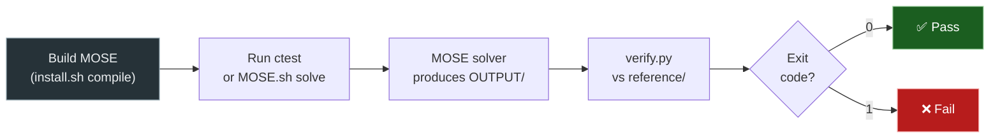

# Testing

MOSE ships with a test suite that exercises the solver on problems with known analytical, manufactured or reference
solutions, and checks the mechanisms around it (restart, input, output, parallel runs). This page describes the layout,
how to run the tests and how to add one. What each test checks, the tiers and the coverage are in the
[test plan](https://github.com/open-hydra/MOSE/blob/main/test/TESTING-PLAN.md).

---

## Test Organisation

```
test/
├── 1D/, 2D/, 3D/   # cases with a reference: MOSE.sh, input, reference/, verify.py (V&V pages: docs/vv)
├── checks/         # small cases that each check one mechanism, in folders of parts (time-integration/time-control, ...)
├── multirate/      # the multirate integrator: one folder per check, mr-<check>; mr-common holds the generator
├── mpi/            # checks that need several ranks (needs-mpi)
├── unit/           # Fortran programs that check one routine, built against the library
├── common/         # shared thermodynamic databases
├── tools/          # tier and inventory scripts for ctest
├── CMakeLists.txt  # every test is registered here: name, kind, labels, one-line description
├── tiers.txt       # the tier of every test
└── TESTING-PLAN.md # what is checked, tiers, coverage, what to add
```

### Categories

| Category | Location | What is checked |
|----------|----------|-----------------|
| **1-D shock tubes** | `test/1D/` | Density, velocity, pressure profiles against exact solutions (ExactPack) |
| **2-D inviscid** | `test/2D/euler/` | Converged Euler flow fields against exact or reference data |
| **2-D viscous** | `test/2D/viscous/` | Converged Navier–Stokes / RANS solutions against reference data, manufactured solutions |
| **3-D** | `test/3D/` | 3-D flow cases |
| **Mechanisms** | `test/checks/`, `test/mpi/`, `test/multirate/` | Identities, invariants, input and output contracts |
| **Common** | `test/common/` | Shared thermodynamic databases used by multiple cases |

---

## Test Case Structure

Each test case is a self-contained directory:

```
test/1D/Sod79/
├── input.ini          # Solver input file
├── INPUT/             # Initial-condition files
├── MESH/              # Grid files
├── reference/         # Reference solution data
├── verify.py          # Comparison script (exit 0 = pass, exit 1 = fail)
└── MOSE.sh            # Run script
```

The key components are:

| File / Dir | Purpose |
|------------|---------|
| `input.ini` | Solver configuration (Riemann solver, CFL, output, ...) |
| `MESH/` | Pre-generated structured grid |
| `INPUT/` | Initial-condition field (ORION format) |
| `reference/` | Reference solution data |
| `verify.py` | Python script that compares solver output against the reference and returns exit code 0 (pass) or 1 (fail) |
| `MOSE.sh` | Convenience script to compile, run, or kill the solver |

---

## Running Tests

The tests are driven by **CTest**. Each test has one **tier**, which follows from its time on the CI runner at one
thread:

| Tier | A test takes | Runs |
|------|--------------|------|
| `light` | under 5 s | pre-push hook, every pull request |
| `medium` | 5 s to 100 s | every pull request |
| `heavy` | 100 s and more | locally, on request |

Each test also carries its kind (`exact`, `order`, `identity`, `invariant`, `robustness`, `contract`, `unit`,
`reference`), its area (`physics`, `numerics`, `implementation`), the dimensions it runs (`1D`, `2D`, `3D`) and, where
it needs an option of the build, `needs-mpi`, `needs-cantera` or `needs-sundials`.

```bash
cd build

ctest -L light                       # the pre-push tier: seconds
ctest -L "light|medium" -j4          # what a pull request runs
ctest -L heavy                       # on request: minutes to days at one thread
ctest -L identity                    # one kind of check
ctest -R Sod79 -V                    # one test, with live output
ctest -R TimeIntegration             # the parts of a check are Area.Part
```

The first CI job builds MOSE with `USE_MPI=OFF`, `USE_TECIO=OFF`, `USE_SUNDIALS=OFF`, `USE_CANTERA=OFF` and runs
`light` and `medium` in parallel. The second job, `test-mpi`, builds with `USE_MPI=ON` (gfortran and the Open MPI of
Ubuntu) and runs the `needs-mpi` tests; it fails when none is registered. Heavy tests do not run on GitHub.

To enable the pre-push hook locally:

```bash
git config core.hooksPath .githooks
```

Individual cases can also be run directly from their own directory, which is handy when iterating on a single
problem.

### Single test case

2-D and 3-D cases are run individually from their own directory:

```bash
cd test/2D/euler/oblique-shock

# Compile a local MOSE binary
./MOSE.sh compile

# Run the solver
./MOSE.sh solve

# Run with OpenMP (4 threads)
./MOSE.sh -p 4 solve

# Run in background
./MOSE.sh -b solve

# Verify against reference
python3 -B verify.py
```

---

## Test Workflow Diagram



---

---

## Adding a New Test Case

### A case with a reference (1-D, 2-D, 3-D)

1. Create a directory under `test/1D/`, `test/2D/euler/`, `test/2D/viscous/` or `test/3D/` (for example
   `test/1D/MyCase/`).
2. Provide `input.ini`, `MESH/` and `INPUT/` with the problem setup.
3. Run the solver to generate a reference solution and save it in `reference/`.
4. Write a `verify.py` that reads the solver output and the reference data, compares the key quantities within a
   tolerance, and calls `sys.exit(0)` on success and `sys.exit(1)` on failure.
5. Copy `MOSE.sh` from an existing case (it is generic). Multi-chemistry cases (for example `rocket-nozzle`) may use a
   subdirectory per chemistry level with a shared `verify.py` at the parent level.

A small check of one mechanism goes in `test/checks/<area>/<part>/run.sh` (a script that exits with 0 when the check
passes), a routine-level check in `test/unit/`.

### Wiring it into CTest

A case runs in the pre-push hook and in CI once it is registered in
[`test/CMakeLists.txt`](https://github.com/open-hydra/MOSE/blob/main/test/CMakeLists.txt) and listed in
[`test/tiers.txt`](https://github.com/open-hydra/MOSE/blob/main/test/tiers.txt):

```cmake
mose_test(MyCase
    DIR 1D/MyCase  RUN "./MOSE.sh solve && python3 -B verify.py"
    KIND exact  LABELS numerics 1D
    DESC "my case against the exact solution")
```

```
# test/tiers.txt: name, tier, seconds on the CI runner ('-' until measured)
MyCase                       medium  -
```

- `KIND` says what a pass means, `LABELS` the area and the dimensions, `DESC` is the one line that appears in the
  list of tests of the test plan. Anything that needs MPI says `REQUIRES MPI`.
- The tier follows from the time: run the test in the CI build with `ctest --output-junit junit.xml`, then
  `python3 test/tools/ctest_tiers.py update junit.xml` writes the seconds and the tier. A test that straddles 5 s or
  100 s is split into parts, each registered on its own (`Area.Part`).
- Two tests that run in the same folder share a `LOCK`, so that `ctest -j` never runs them together.
- `python3 test/tools/inventory.py build` regenerates the list of tests of the test plan; CI fails when it is stale.

---

## Common Thermodynamic Data

The `test/common/` directory contains shared species databases:

| Directory | Content |
|-----------|---------|
| `Air/` | 5-species air (N₂, O₂, NO, N, O) with dimensional transport |
| `nondim-Air/` | Same mixture in non-dimensional form |
| `Air-sutherland/` | Transport table of air: viscosity and conductivity |
| `Air-viscous/` | One-species air: phase, thermodynamic and transport tables |
| `CHO-N2-viscous/` | The eight species of the surface reactions of a carbon wall (O₂, O, OH, H, H₂, H₂O, CO, CO₂) and N₂: phase, thermodynamic (1..3000 K), transport and composition tables, written by ATLAS GPB (provenance in its `README.md`) |

Test cases symlink to these files rather than duplicating them.

---

## Reference Solution Generation

The 1-D reference solutions are generated using
[ExactPack](https://github.com/lanl/ExactPack), which provides exact
Riemann-problem solvers for canonical test cases (Sod, Toro, Einfeldt,
Noh, etc.).

ExactPack is not on PyPI and is not a submodule: install
it from LANL's GitHub, pinned to the tag CI uses:

```bash
pip install "ExactPack @ git+https://github.com/lanl/ExactPack.git@1.7.11"
```

The `verify.py` scripts use ExactPack to compute the exact solution
on the same grid and compare point-by-point.
