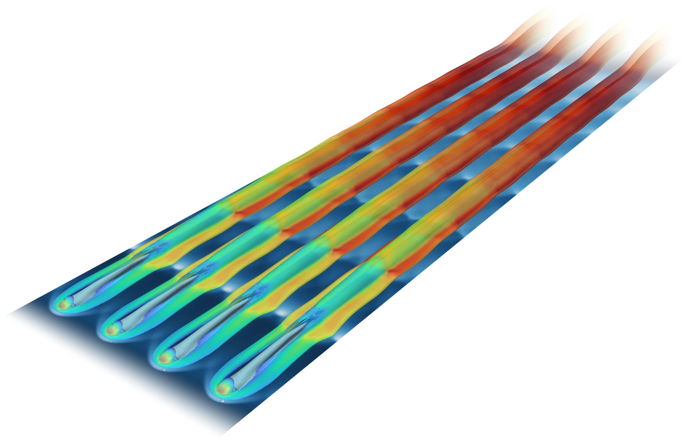

HYDRA CFD SUITE

<h1 class="mose-hero__title">MOSE</h1>

Open-source solver for compressible flows on multi-block structured grids, from shock
tubes to turbulent reacting flows.

$ ./MOSE.sh solve -p 4

[Get started](getting-started/index.md){ .md-button .md-button--primary }
[Verification](vv/index.md){ .md-button .mose-hero__ghost }

<strong>M</strong>ultipurpose <strong>O</strong>pen <strong>S</strong>olver for
ideal-gas <strong>E</strong>quations

[HyShot II scramjet](vv/3D-hyshotII.md): hydrogen jets burning in a
supersonic crossflow

The solver

## Compressible flow, from shock tubes to scramjets { .mose-heading }

MOSE solves the Euler and Navier–Stokes equations for mixtures of thermally perfect
gases. Start with the [Quick Start](getting-started/quick-start.md): a shipped case runs in a few minutes.

[:material-weather-windy: <b>Euler and Navier–Stokes</b> <i>Steady or time-accurate flows of ideal-gas mixtures, inviscid or viscous, in 1-D, 2-D and 3-D.</i>](theory/governing-equations.md){ .mose-tool }
[:material-chart-bell-curve: <b>Shock-capturing numerics</b> <i>Finite volumes with MUSCL reconstruction and Riemann solvers of the HLL, AUSM, SLAU and Roe families, low-Mach variants included.</i>](theory/riemann-solvers.md){ .mose-tool }
[:material-fire: <b>Reacting flows</b> <i>Finite-rate kinetics integrated by stiff ODE solvers, or NASA CEA chemical equilibrium.</i>](theory/kinetics.md){ .mose-tool }
[:material-waves: <b>Turbulence</b> <i>RANS closures: Spalart–Allmaras with rotation corrections, Menter SST, Wilcox k-ω 2006 and the SSG/LRR-ω Reynolds-stress model.</i>](theory/turbulence.md){ .mose-tool }
[:material-chip: <b>Parallel runs</b> <i>OpenMP and MPI, alone or together, on multi-block grids from a laptop to a cluster.</i>](user/parallel.md){ .mose-tool }
[:material-file-chart-outline: <b>Inputs and outputs</b> <i>Tecplot and VTK files, point probes for time histories, and restarts.</i>](user/using.md){ .mose-tool }

## Hydra CFD Suite { .mose-heading }

Hydra couples solvers of gases, real fluids, solids, particles and radiation in one
simulation. MOSE is its ideal-gas flow solver.

Your case

:material-grid: structured mesh

:material-database: [databases](https://open-hydra.github.io/ATLAS/databases/)

ATLAS

[GPB](https://open-hydra.github.io/ATLAS/user-guide/gpb/) [BCB](https://open-hydra.github.io/ATLAS/user-guide/bcb/) [ICB](https://open-hydra.github.io/ATLAS/user-guide/icb/) [STB](https://open-hydra.github.io/ATLAS/user-guide/stb/) [MDB](https://open-hydra.github.io/ATLAS/user-guide/mdb/) [KAnT](https://open-hydra.github.io/ATLAS/user-guide/kant/)

input files for each run

[Hydra](https://github.com/open-hydra) · the coupled simulation

[<b>MOSE</b> compressible flow <i>ideal-gas</i>](https://github.com/open-hydra/MOSE){ .hydra__solver .hydra__solver--gas .is-here }
[<b>GROOT</b> radiative transfer <i>no ATLAS phase</i>](https://github.com/open-hydra/GROOT){ .hydra__solver .hydra__solver--radiation }
[<b>ARES</b> real-fluid flow <i>real-fluid</i>](https://github.com/open-hydra/ARES){ .hydra__solver .hydra__solver--fluid }
[<b>FUSS</b> heat conduction in solids <i>solid</i>](https://github.com/open-hydra/FUSS){ .hydra__solver .hydra__solver--solid }
[<b>IGLOO</b> Lagrangian particles <i>dispersed</i>](https://github.com/open-hydra/IGLOO){ .hydra__solver .hydra__solver--particle }
[<b>ICE</b> Eulerian particles <i>dispersed</i>](https://github.com/open-hydra/ICE){ .hydra__solver .hydra__solver--particle }

Built on

[<b>ORION</b> Tecplot, VTK and PLOT3D I/O](https://MarcoGrossi92.github.io/ORION/){ .hydra__lib }
[<b>FLINT</b> thermochemistry](https://MarcoGrossi92.github.io/FLINT/){ .hydra__lib }
[<b>OSLO</b> ODE integrators](https://github.com/MarcoGrossi92/OSLO){ .hydra__lib }
[<b>FiNeR</b> INI file parser](https://github.com/szaghi/FiNeR){ .hydra__lib }

[Quick Start](getting-started/quick-start.md)
[User Guide](user/index.md)
[Input Parameters](user/registry.md)
[Theory](theory/index.md)
[Verification](vv/index.md)
[Developer Guide](development/index.md)

